# HA Taskbar

[Français](README.md) · **English**

Your Home Assistant **sensors** and **buttons**, always in sight: on the **Windows 11 taskbar** and in the **Mac menu bar**. One click to turn a light on, a glance for the temperature, a full control card when you need it.

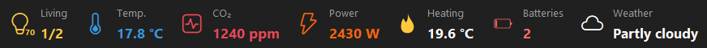

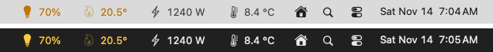

*Top, Windows: a group of lights with a brightness badge, colors by value (temperature, CO₂, power), a heating flame that moves while heating, the low battery summary and the weather. Bottom, the Mac, light and dark (its interface is in French for now). All screenshots use demo data.*

<p align="center">
  <a href="https://github.com/bbtoff/home-assistant-taskbar/releases/latest"><b>⬇️ Download the latest version</b></a>
  &nbsp;·&nbsp; <a href="#-installation">Installation</a>
  &nbsp;·&nbsp; <a href="#-ha-taskbar-on-mac">On Mac</a>
  &nbsp;·&nbsp; <a href="#-security-and-privacy">Security</a>
</p>

---

## 👀 At a glance

### On the bar, in real time

- 📊 **Live values** (under a second): temperature, power use, state of a light, a timer's countdown…
- 💡 **One click** turns things on or off, runs a scene or a script; the **mouse wheel** sets brightness, volume, target temperature…
- 🎨 About 90 icons (almost 200 on Mac) that change **color with the state or the value** (`> 25 orange ; > 30 red`), with an automatic **light / dark** theme.
- 〰️ A **mini chart** of the last 6 hours next to a value, and a **tooltip** with the history on hover.
- 🇬🇧 🇫🇷 **English and French** on Windows: the language follows Windows.

<p align="center">
  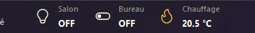
</p>

**Animated icons**: a flame burns while the heating heats, a fan spins, a bell rings, a washing machine turns… Slow and subtle, still when the device is off.

<p align="center">
  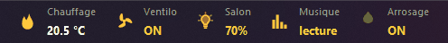
  <br>
  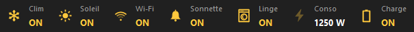
</p>

On Mac too: the heating flame pulses, the air conditioner's snowflake spins, and the timer counts down every second.

<p align="center">
  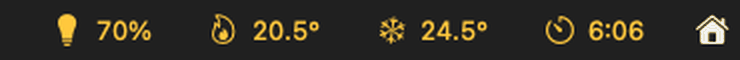
</p>

### A control card for every device

A **long press** (or hovering, on Mac) opens the card, like in Home Assistant: brightness, color and scenes of a light, target and modes of a thermostat, speed and direction of a fan, position of a cover, a media player with its **album art**, a **live camera image**, a 5-day weather forecast, history over 24 h, 7 days or 30 days…

<p align="center">
  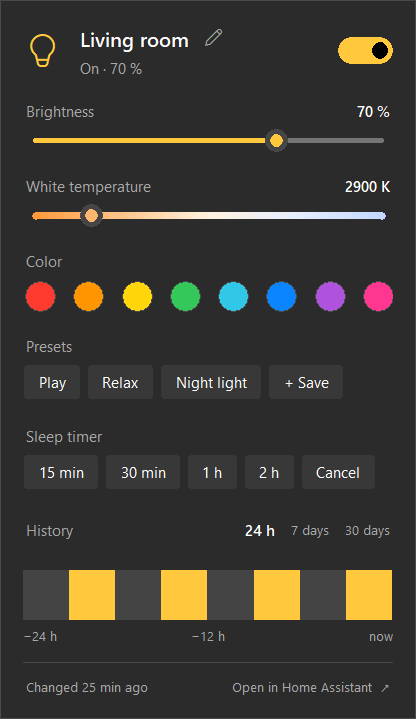
  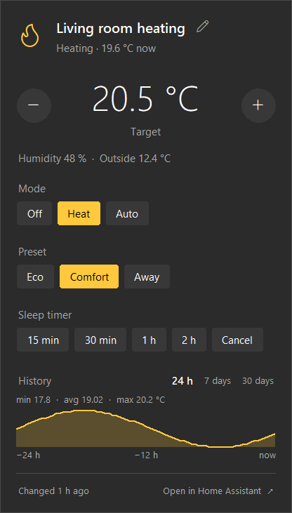
  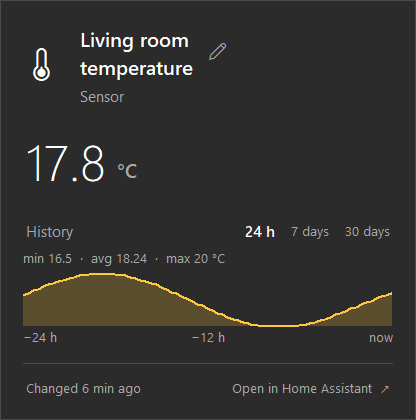
</p>

<p align="center">
  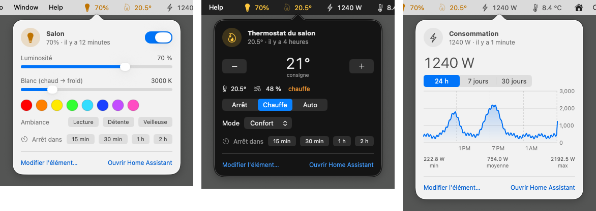
</p>

### 🏠 The panel: the whole house in one click

One button opens all your items, **grouped by room**, like Windows 11 Quick Settings or the Mac Control Center: search, toggles, sliders, +/− buttons for a thermostat, pictures, **camera images**. Drag its edges to make it bigger: it spreads over **several columns**. Great when the bar runs out of room (and with the MacBook notch).

<p align="center">
  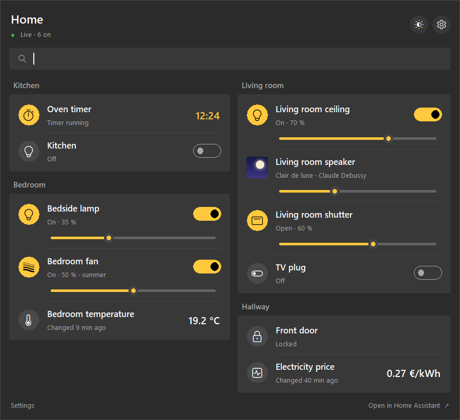
  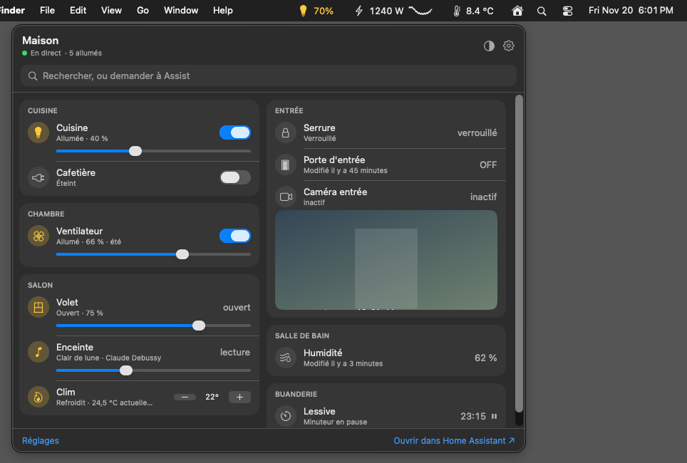
</p>

### ⏱️ Timers and 📷 cameras

A timer's **countdown** runs on the bar; a click pauses it. When someone **rings**, a small window opens with the **live camera image**, without taking the keyboard, and closes by itself after a minute.

<p align="center">
  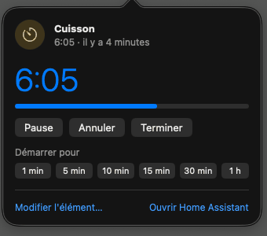
  &nbsp;
  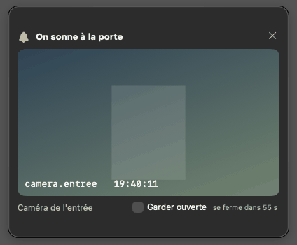
</p>

### 💬 Assist: talk to your home

Type a sentence ("turn on the living room", "what time is it"): Home Assistant answers right away. On Windows in the **command palette** (`Ctrl+Alt+Space`, from any app), on Mac in the **panel**'s search field.

<p align="center">
  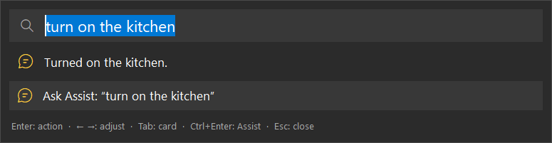
  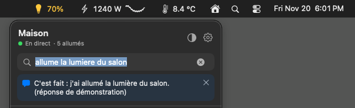
</p>

### 📊 Desktop widgets

**Charts of your sensors** on the desktop, under your windows: 24 h, 7 days or 30 days, several sensors on the same chart, or a big value. Updated in real time, with an icon or your own logo.

<p align="center">
  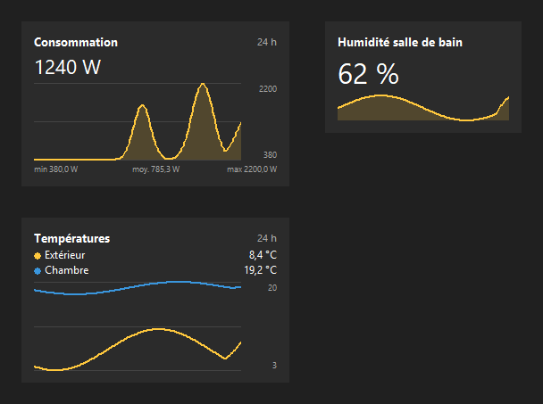
  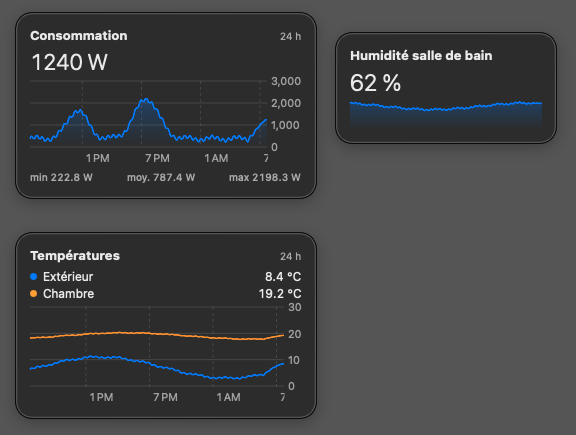
</p>

### 🔔 And also

- **Notifications** when a door opens, a machine is done, Home Assistant stops answering… and from your automations.
- **Sleep timer** (15 min to 2 h), **groups** ("all lights"), **time ranges** for showing an item, **low battery summary**.
- Global **keyboard shortcuts** and **multiple screens** (Windows).
- A **settings window** with live preview, **suggestions** as soon as you type an entity name, **import / export** of the configuration (without the token).
- Checked **automatic updates** (SHA-256 hash), an **encrypted token** (Windows) or stored in the **Keychain** (Mac).

<p align="center">
  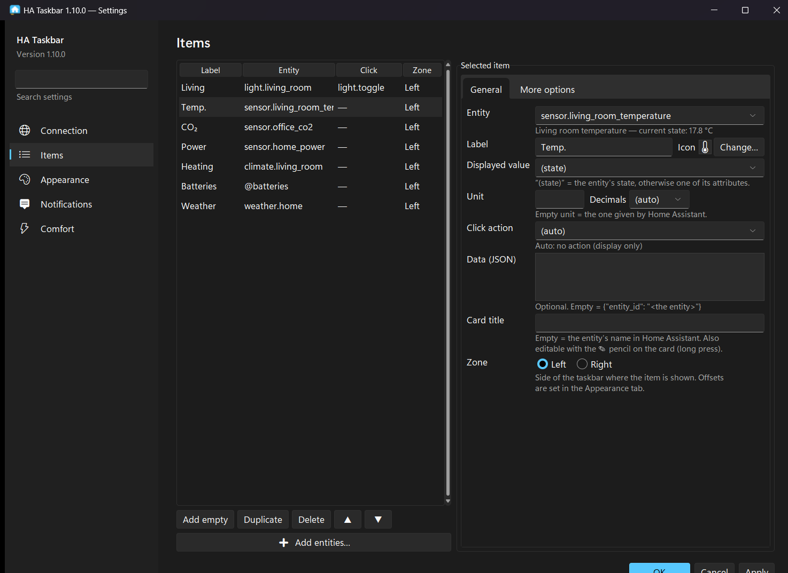
  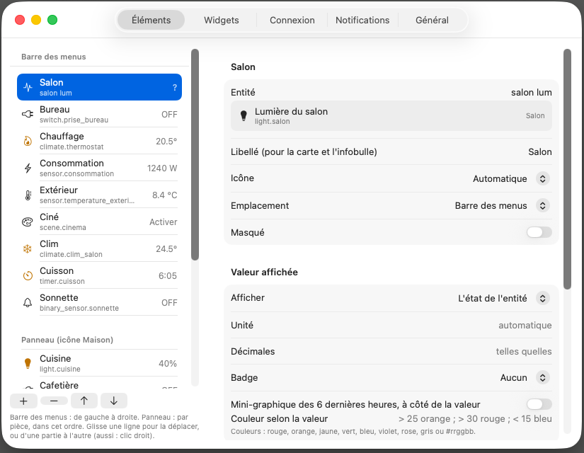
</p>

An **installer** and a **portable version** are provided for Windows, and a **one-command install** for the Mac: nothing else to install, not even Python. What's new in each version is described in the [**Releases**](https://github.com/bbtoff/home-assistant-taskbar/releases).

---

## 📑 Contents

1. [Requirements](#-requirements)
2. [Installation](#-installation)
3. [Security and privacy](#-security-and-privacy)
4. [First start](#-first-start)
5. [Everyday use](#-everyday-use)
6. [Settings in detail](#-settings-in-detail)
7. [Configuration examples](#-configuration-examples)
8. [Configuration file](#-configuration-file)
9. [How it works](#-how-it-works)
10. [Project structure](#-project-structure)
11. [Known limitations](#-known-limitations)
12. [Troubleshooting](#-troubleshooting)
13. [HA Taskbar on Mac](#-ha-taskbar-on-mac)
14. [About this project](#-about-this-project)

---

## 📋 Requirements

- **Windows 11** (also works on Windows 10, with the Segoe MDL2 icons), or **macOS 13** and later (see [HA Taskbar on Mac](#-ha-taskbar-on-mac))
- Only to run from source: **Python 3.8 or later** (tested with 3.10), with tkinter. That's the default with the python.org installer.
- A **Home Assistant** reachable from the PC, and a **long-lived access token**

### 🔑 Create the Home Assistant access token

1. In Home Assistant, click **your profile** (bottom left).
2. Open the **Security** tab.
3. At the very bottom, under **Long-lived access tokens**, click **Create token**.
4. Give it a name (e.g. “HA Taskbar”) and copy the token. It won't be shown again.

---

## 📦 Installation

This part is about Windows. On Mac, it's a single command: see [HA Taskbar on Mac](#-ha-taskbar-on-mac).

### With the installer (recommended)

1. Download `HATaskbar-Setup-<version>.exe` from the repository's [**Releases**](https://github.com/bbtoff/home-assistant-taskbar/releases) page.
2. Run it. No administrator rights are needed: the program installs for your account, in `%LOCALAPPDATA%\Programs\HA Taskbar`.
3. Options: **start with Windows** (checked) and **desktop icon**.

Once installed, HA Taskbar is in the Start menu and can be uninstalled from **Settings → Apps → Installed apps**. Uninstalling also offers to delete the settings, token included.

To update, just run the new installer: it closes HA Taskbar, replaces the files and keeps your settings.

> The program is not digitally signed: on first launch, Windows SmartScreen may show “Windows protected your PC”. Click **More info**, then **Run anyway**. To check the file first, see [Security and privacy](#-security-and-privacy).

### Portable version (no installation)

To try HA Taskbar without installing anything:

1. Download `HATaskbar-Portable-<version>.zip` from the [**Releases**](https://github.com/bbtoff/home-assistant-taskbar/releases) page.
2. Unzip it into a folder you can write to: Documents, Desktop, USB drive… (not `Program Files`).
3. Run `HATaskbar.exe` in the `HA Taskbar` folder.

Your settings, token included (encrypted for your Windows account), stay in this folder (`config.json`): nothing is written to `%APPDATA%` or to the registry, unless you check **Start HA Taskbar with Windows**. To remove everything, uncheck that box if needed, quit HA Taskbar and delete the folder. The `portable.txt` file turns this mode on: don't delete it.

The portable version tells you about new versions but doesn't update itself: download the new `.zip` and replace the contents of the folder, keeping your `config.json`.

As with the installer, Windows SmartScreen may show a warning on first launch.

### From source

```powershell
git clone https://github.com/bbtoff/home-assistant-taskbar.git
cd home-assistant-taskbar
pythonw ha_taskbar.py
```

`pythonw` runs the program without a console window. To see possible errors, use `python` instead.

### Build the installer

```powershell
winget install -e --id JRSoftware.InnoSetup --scope user   # once
powershell -ExecutionPolicy Bypass -File build.ps1
```

`build.ps1` installs PyInstaller in a dedicated virtual environment (`%LOCALAPPDATA%\HATaskbar-build`) and builds `HATaskbar.exe`. It makes the portable version `dist\HATaskbar-Portable-<version>.zip`, then hands it to Inno Setup, which produces `dist\HATaskbar-Setup-<version>.exe`. At the end it prints the SHA-256 hash of both files. The version number comes from `__version__` in [`ha_core.py`](ha_core.py).

### 🔄 Updates

When a new version is published on the [Releases](https://github.com/bbtoff/home-assistant-taskbar/releases) page, a small window opens with what's new:

- **Install now**: the installer is downloaded from GitHub, then **verified** (exact size and the SHA-256 hash published by GitHub). HA Taskbar closes, updates and restarts on its own. Your settings are kept.
- **Later**: the window closes, and the bar's right-click menu offers **Update to version…** until it's done.
- **Skip this version**: no more reminders for this version, only for the next one.

At any time: right-click → **Check for updates**, or **Settings → Connection → Check now**. Automatic checking can be turned off in the same tab.

The check uses GitHub's public API, without an account or token, and sends nothing about you or your home. From source (`python ha_taskbar.py`), the window only offers to open the release page.

> Release notes are written in French.

---

## 🔒 Security and privacy

HA Taskbar is a personal, fully open-source project. Here is exactly what it does, so you can install it knowing what you get.

### What leaves your PC

| Destination | Why | What is sent |
|---|---|---|
| **Your Home Assistant**, at the address entered in the settings | Read states, history and areas, receive changes in real time, send the commands you trigger | Your access token, the commands |
| **api.github.com** and **github.com** | Check for and download updates (can be turned off in **Settings → Connection**) | Nothing but the HA Taskbar version number |

That's all: **no telemetry**, no statistics, no ads, no account. The **Open in Home Assistant** link on a card just opens your browser.

### The access token

- It is **encrypted** in `config.json` (`%APPDATA%\HATaskbar\` for the installed version, next to the program for the portable version and from source), with **Windows data protection** (DPAPI). Only your Windows account, on this PC, can decrypt it: the file no longer holds the token in plain text (`token_protected` key), and a copy of the file isn't enough to read it on another computer.
- Older configurations, with the token in plain text, are encrypted automatically on first start.
- A program running **under your account**, on this PC, can still ask Windows to decrypt it: that's the limit of any app that must reconnect on its own without asking you for a password.
- On another PC or Windows account (a portable version copied to a USB drive, for example), the token can't be decrypted: HA Taskbar simply asks you to paste it again.
- Create a **dedicated token** named “HA Taskbar”: if in doubt, delete it in Home Assistant (**profile → Security**) without touching your other access.
- Uninstalling offers to delete the settings, token included.
- Keep **Verify the HTTPS certificate** checked (**Settings → Connection**). Only uncheck it for a Home Assistant using HTTPS with a self-signed certificate, on your local network.

### What changes on your PC

With the installer:

- The program folder: `%LOCALAPPDATA%\Programs\HA Taskbar`
- The settings folder: `%APPDATA%\HATaskbar`
- A single registry value, `HATaskbar` in `HKCU\Software\Microsoft\Windows\CurrentVersion\Run`, if starting with Windows is checked

With the [portable version](#portable-version-no-installation), only its own folder, plus the registry value if you check starting with Windows.

No administrator rights, no service, no driver. Automatic updates only install the installer published in this repository's [Releases](https://github.com/bbtoff/home-assistant-taskbar/releases), after checking its size and SHA-256 hash.

### Check the installer

1. **SHA-256 hash**: it's in each release's notes, and next to the file on the Releases page. To compare, in PowerShell:
   ```powershell
   Get-FileHash .\HATaskbar-Setup-1.9.0.exe
   ```
   Upper or lower case doesn't matter: the 64 characters must be identical.
2. **VirusTotal scan**: releases link to their report. Programs built with PyInstaller are sometimes wrongly flagged by a few lesser-known antivirus engines (often 1 to 5 out of 70+): it's a known false positive, caused by the launcher PyInstaller adds to every Python program.
3. **Without installing anything**: the [portable version](#portable-version-no-installation) goes away with its folder.
4. **Without trusting the .exe**: you can [run HA Taskbar from source](#from-source), or [build the installer yourself](#build-the-installer) with `build.ps1`.

To report a security issue, see [SECURITY.md](SECURITY.md).

---

## 🚀 First start

On first start, the **Settings** window opens by itself:

1. **Connection tab**: enter the Home Assistant address (e.g. `http://homeassistant.local:8123`) and paste the token, then click **Test connection**. Your Home Assistant's name and version are shown, with the number of entities.

   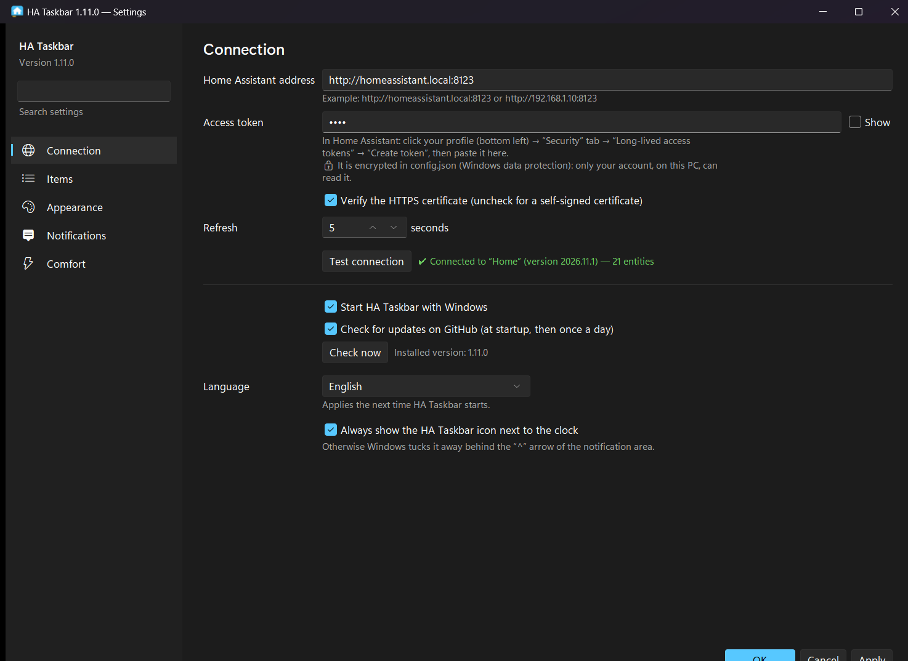

2. **Items tab**: click **➕ Add entities…**, search your entities (by name, type or area), then double-click to add them to the bar.

   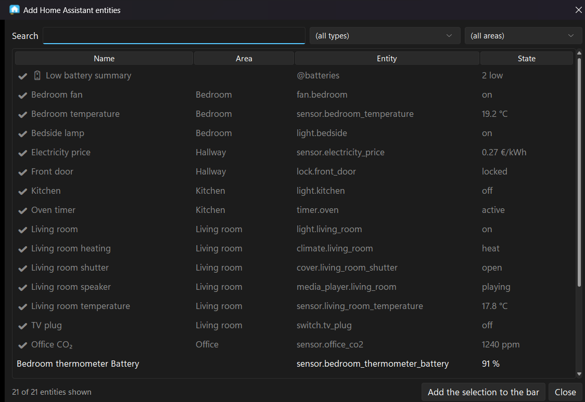

3. Click **OK**. The bar appears on the taskbar.

To start HA Taskbar with Windows, check **Start HA Taskbar with Windows** in the Connection tab.

---

## 👆 Everyday use

| Action | Effect |
|---|---|
| **Click** a button | Action by type: turns a light, plug or fan on/off, runs a scene or script, presses a button… |
| **Long press** (½ second) | Opens the item's [control card](#-control-card-long-press) |
| **Click** a sensor | Opens its card directly, since a sensor has no action |
| **Mouse wheel** | Light brightness, fan speed, player volume, cover position, thermostat target, number value |
| **Middle click** (wheel) | Opens the card, or the action chosen in **Settings → Items → More options** |
| **Keyboard shortcut** | The click action, from any app (set per item) |
| **Hover** | Tooltip: value, last change, chart of the last 6 hours |
| **Ctrl + drag** an item | Moves it on the bar, or to the other zone |
| **Right-click** an item | Edit it, open its card, hide it |
| **Right-click** anywhere | Menu: command palette, hidden items, pause notifications, Settings…, Refresh, Quit |
| **Ctrl+Alt+Space** | [Command palette](#️-command-palette) |
| **Icon near the clock** | Left click: settings. Right click: the same menu |
| **● HA offline** in red | Home Assistant isn't responding: values are greyed out. Right-click to see the error and retry, left-click to open the settings. |

The bar hides automatically when an app goes full screen (game, video).

### ⌨️ Command palette

`Ctrl+Alt+Space` (can be changed in **Settings → Comfort**) opens a search box in the middle of the screen, whatever app is active. It searches **all** Home Assistant entities, by name, ID or area, ignoring accents. Items on your bar and controllable entities come first.

| Key | Effect |
|---|---|
| **Enter** or click | Action: turn on / off, run the scene… (opens the card for a sensor or thermostat) |
| **← →** or wheel | Adjust: brightness, speed, volume, position, target |
| **Tab** | Opens the entity's card |
| **↑ ↓** | Move between rows |
| **Esc** | Close (pressing the shortcut again too) |

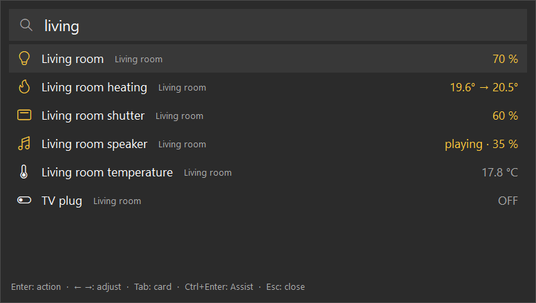

### 💬 Tooltip

When you hover over an item, a tooltip shows its full name, its value, when it last changed and a chart of the last 6 hours (or an on / off timeline):

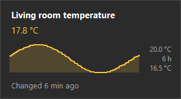

### 🧩 Control card (long press)

A long press on an item opens a card just above the taskbar, in the spirit of Home Assistant's more-info dialog. Its content depends on the entity type:

<p>
  
  
  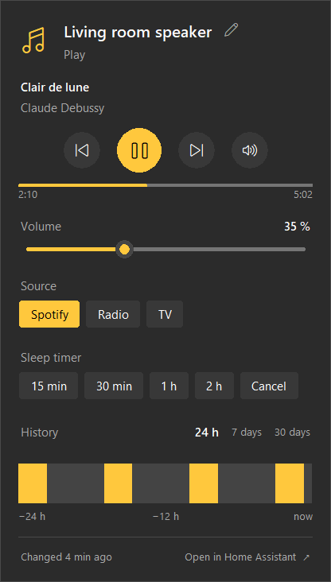
  
  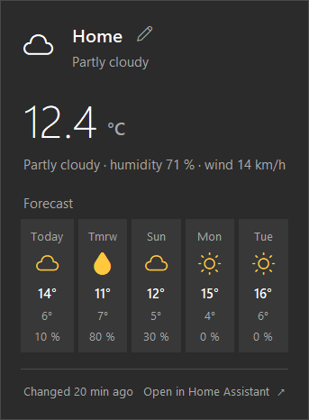
</p>

| Entity type | Card content |
|---|---|
| Light | Switch, brightness, white temperature and colors, depending on the bulb. Presets and saved favorites |
| Thermostat | Target with − / + (or wheel), humidity and outdoor temperature, modes (off, heat, auto…) and presets (eco, comfort…) |
| Cover | Open / Stop / Close, position with 25 / 50 / 75 % shortcuts, tilt |
| Media player | Title and artist, previous / play-pause / next, mute, progress, volume, source |
| Fan | Switch, speed (slider, or 1, 2, 3… buttons if it has few speeds), modes, direction, oscillation |
| Vacuum | Start / Pause / Dock / Locate, battery, suction power |
| Group | One switch per member (and the brightness of lights) |
| Weather | Temperature, conditions, humidity, wind and 5-day forecast |
| Battery summary | Batteries below the threshold, from the emptiest |
| Plug, switch, automation | Switch |
| Lock | Lock / Unlock |
| Number, select | Slider or option buttons |
| Scene, script, button | Activation button |
| Sensor and others | Large value |

Lights, plugs, fans, players and thermostats have a **sleep timer** (15 min to 2 h). HA Taskbar turns the device off at the set time, so it must keep running.

When the entity belongs to a device that has others (the light of a ceiling fan, its timer, a sensor…), the card shows them under **On the same device**, with their controls.

Every card, except those of scenes, scripts and buttons, shows the **history** over 24 h, 7 days or 30 days (Home Assistant keeps 10 days by default). It's a chart for a numeric value, with minimum, average and maximum, or a colored timeline for an on/off state. Hover to see the value and time. The **Open in Home Assistant** link opens the full history in the browser.

Sliders only send the command when you release the mouse, so Home Assistant isn't flooded with requests. The thermostat target is sent 0.7 s after the last click on − / +.

Change the card **title** with the **✎** pencil next to it (or double-click it). **Enter** saves and **Esc** cancels. An empty title restores the entity's name in Home Assistant. The title is saved in your config (`card_title`), can also be edited in the Items tab, and changes nothing in Home Assistant.

Close the card with **Esc**, or by clicking anywhere outside it.

#### 🎨 Card themes

In **Settings → Appearance → Control card**, choose a theme and its colors (like the bar, always dark or always light). A preview updates with each change, and **Open the card on the bar** shows the real result.

| Theme | Feature |
|---|---|
| Like the bar (default) | Neutral grey, accent = the bar's “Active / on” color |
| Windows 11 | Neutral grey, accent = your Windows accent color |
| Home Assistant | Home Assistant's interface colors, very rounded buttons |
| Ocean, Forest, Twilight | Colorful moods |
| High contrast | Black/white with bright yellow or blue, square corners |

Each theme has a **dark** and a **light** version.

**Make your own themes**: **Custom themes…** creates and opens `card_themes.json`, in the same folder as `config.json`. It contains an example to copy:

```json
{
  "my_theme": {
    "name": "My theme",
    "radius": 8,
    "dark":  { "bg": "#0f1e2b", "surface": "#17304a", "surface_h": "#1f3d5c", "border": "#24486b",
               "fg": "#e6f1ff", "dim": "#8aa4bf", "knob": "#17304a", "accent": "#2ec4b6" },
    "light": { "bg": "#f2f8fc", "surface": "#dcebf5", "surface_h": "#cde1ef", "border": "#c2d8e8",
               "fg": "#0f2a3f", "dim": "#4f6b82", "knob": "#ffffff", "accent": "#0f8b8d" }
  }
}
```

| Key | Role |
|---|---|
| `bg` | Card background |
| `surface` / `surface_h` | Button background, normal and on hover |
| `border` | Card outline |
| `fg` / `dim` | Main text / secondary text |
| `knob` | Round slider handle |
| `accent` | Active color (sliders, switch, selected option). `"bar"` uses the bar's color, `"system"` the Windows one. |
| `radius` | Button rounding, in pixels (0 to 16) |

A missing key uses the default theme's value. After saving the file, click **↻** to reload the list.

---

## 🔧 Settings in detail

### Connection tab
- Home Assistant **address** and **token**
- **Verify the HTTPS certificate**: uncheck for a self-signed certificate
- **Refresh**: how often states are read, in seconds (5 by default). After a click, the update is immediate.
- **Start HA Taskbar with Windows**: adds or removes the `HATaskbar` entry in `HKCU\Software\Microsoft\Windows\CurrentVersion\Run`
- **Language**: automatic (the Windows language), French or English. After a change, HA Taskbar offers to restart.

### Items tab


- **Add entities…**: browse all entities, with a multi-word search and filters by type and area. Entities already on the bar are greyed out (✔).
- **▲ ▼** to reorder, **Duplicate**, **Delete**
- For each item, **General** tab:
  - **Label** and **Icon**: automatic by type, one of 100+ (18 animated), or none
  - **Displayed value**: the entity's state or one of its attributes (e.g. a thermostat's `current_temperature`)
  - **Unit** and **Decimals**
  - **Click action**: automatic, none, or any service (e.g. `light.turn_on`)
  - **Data (JSON)**: parameters sent to the service (e.g. `{"entity_id": "light.living_room", "brightness_pct": 30}`)
  - **Card title**: title shown on the long-press card. Empty = the entity's name in Home Assistant.
  - **Zone**: left or right of the taskbar
- **More options** tab:
  - **Middle click**: open the card (default), reverse direction, next mode, sleep timer, mute, nothing, or a service
  - **Badge**: small info at the bottom right of the icon (direction, percentage, battery or an attribute). A running sleep timer always shows there.
  - **Group with**: other entities controlled by the same button
  - **Keyboard shortcut**: e.g. `Ctrl+Alt+1`, `Ctrl+Shift+L` or `F9`. If another app already uses it, the right-click menu says so.
  - **Shown from … to …**: time range, which can span midnight (22:00 → 07:00)
  - **Color by value**: rules separated by `;`, like `> 25 orange ; > 30 red ; < 15 blue` (see [examples](#-color-by-value))
  - **Hide this item from the bar**: it stays in the list, to show it again later (also from the right-click menu on the bar)

**Change…** next to the icon opens a choice of about 90 Windows 11 icons. The **animated icons** are at the bottom and play in the window as a preview.

Automatic click actions:

| Entity type | Action |
|---|---|
| `light`, `switch`, `input_boolean`, `fan`, `cover`, `automation` | `toggle` |
| `script`, `scene` | `turn_on` |
| `button`, `input_button` | `press` |
| `media_player` | `media_play_pause` |
| `sensor`, `binary_sensor`, … | none (display only) |
| group (“Group with”) | turn everything on, or everything off if one is on |

For scenes, buttons and scripts, the bar shows “Activate”, “Press” or “Run” instead of the state: Home Assistant puts the date of the last trigger there, which isn't useful here.

### Appearance tab

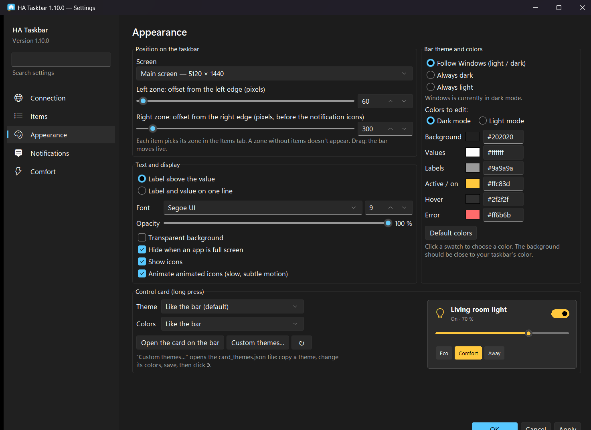

- **Screen** (multi-monitor): the screen showing the buttons. Windows must show the taskbar on that screen (*Settings → Personalization → Taskbar → Taskbar behaviors → Show my taskbar on all displays*).
- **Position**: the bar has two zones, **left** and **right** (just before the notification icons). Each has its own **offset** in pixels from its edge, and the slider moves it live. Each item picks its zone in the Items tab, and a zone without items doesn't appear.
- **Layout**: label above the value, or both on one line.
- **Bar theme**: **Follow Windows** (default), **Always dark** or **Always light**. The bar has two color sets, one for dark mode and one for light mode, and switches by itself within about 2 seconds when you change the Windows mode. “Colors to edit” tells which set you are editing.
- **Transparent background**: the Windows taskbar shows through behind the buttons. Since Windows icons stay visible through it, keep the bar in a free area. Hovering shows a rectangle in the “Hover” color.
- **Font**, **size**, **opacity**, **show icons**, **animate animated icons**, **hide in full screen**
- **Colors**: background, values, labels, active/on, hover, error, for each mode. **Default colors** restores the originals.
- **Control card**: theme and colors of the long-press card (see [Card themes](#-card-themes)).

### Notifications tab

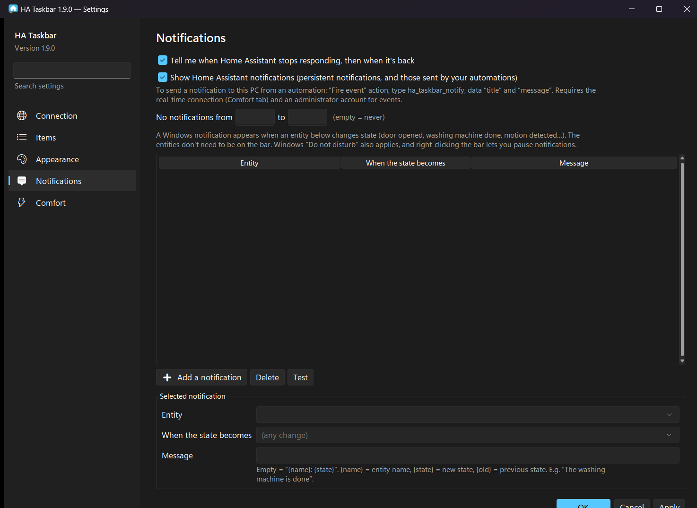

- **Tell me when Home Assistant stops responding**: one notification when the connection is lost, another when it's back
- **Show Home Assistant notifications**: persistent notifications (update available, new device…) and those from your automations. To send one to the PC, add a **Fire event** action to an automation:
  ```yaml
  action: event
  event: ha_taskbar_notify
  event_data:
    title: Washing machine
    message: The cycle is done
  ```
  This needs the real-time connection (Comfort tab). Receiving these events requires a token created with an **administrator** account.
- **No notifications from … to …**: quiet hours, which can span midnight. Right-clicking the bar also lets you **pause** notifications (1 h, 3 h, until 8 am tomorrow), and Windows **Do not disturb** applies.
- **State notifications**: choose an entity, optionally the state that triggers it (`on`, `open`, `off`…), and a message. In the message, `{name}` is the entity's name, `{state}` its new state and `{old}` the previous state. **Test** shows the notification right away.

Notifications look like those of other apps and appear in the Windows notification center.

### Comfort tab

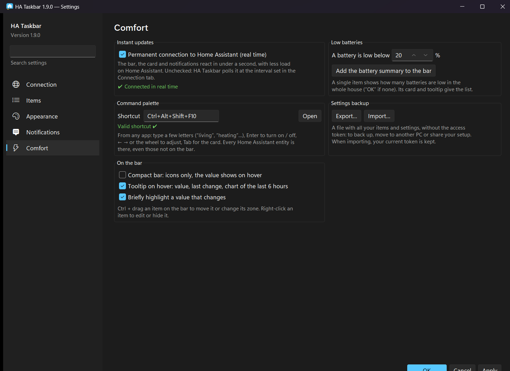

- **Instant updates**: permanent connection to Home Assistant, with its status below. Unchecked, HA Taskbar polls Home Assistant at the Connection tab's interval.
- **Command palette**: its shortcut (empty = only from the right-click menu), and a button to try it.
- **On the bar**: compact bar (icons only), tooltip on hover, value that lights up when it changes.
- **Low batteries**: the threshold (20 % by default), and a button that adds the battery summary to the bar.
- **Backup**: **Export…** writes a file with all your settings, without the access token. **Import…** replaces them, keeping your token.

The **Search settings** box at the top left of the window finds an option on any page and shows it.

All changes are **previewed live** on the bar. **Apply**/**OK** saves, **Cancel** goes back to the previous state.

---

## 🧪 Configuration examples

On this demo bar, each item shows a different feature:


| Item | Setting | What you see |
|---|---|---|
| **Living** (`light.living_room`) | **Group with** `light.kitchen`, **Badge** Percentage, **Middle click** Sleep timer: 30 min, **Shortcut** `Ctrl+Alt+1` | “1/2”: one of the two lights is on, and the small “70” on the icon is its brightness |
| **Temp.** | **Color by value** `< 19 blue ; > 24 orange ; > 26 red` | 17.8 °C: blue, it's cool |
| **CO₂** | `> 800 orange ; > 1200 red` | 1240 ppm: red, time to open a window |
| **Power** | `> 2000 orange ; > 3000 red` | 2430 W: orange |
| **Heating** (`climate.living_room`) | **Displayed value** `current_temperature`, **Unit** °C, **Decimals** 1, **Animated flame** icon | the room temperature; the flame moves while the heating heats |
| **Batteries** | entity `@batteries` (Settings → Comfort → Add the battery summary) | 2 batteries below 20 %, in red |
| **Weather** (`weather.home`) | nothing special | current conditions, with their icon |

### 🎨 Color by value

In **Items → More options → Color by value**, write one or more rules separated by `;`. Each rule has a comparison (`>`, `>=`, `<`, `<=` or `=`), a number (dot or comma) and a color. Both the value **and** the icon take the color:

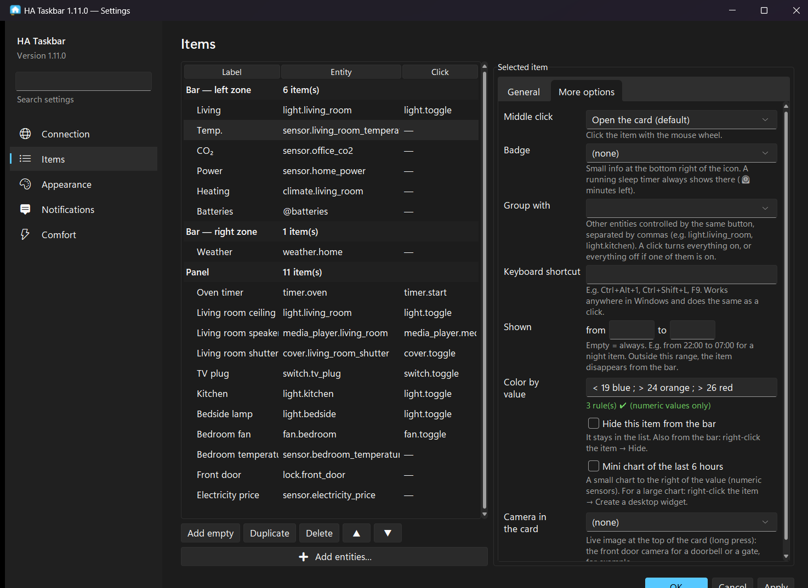

When several rules match, **the most specific one wins**: with `> 24 orange ; > 26 red`, 27 °C is red; with `< 40 orange ; < 20 red`, 15 % is red. The order you write them in doesn't matter.

Ready-to-copy rules:

| Sensor | Rules |
|---|---|
| Indoor temperature (°C) | `< 19 blue ; > 24 orange ; > 26 red` |
| Indoor temperature (°F) | `< 66 blue ; > 75 orange ; > 79 red` |
| Outdoor temperature (°C) | `< 0 blue ; > 30 red` |
| Humidity (%) | `< 35 orange ; > 65 blue` |
| CO₂ (ppm) | `> 800 orange ; > 1200 red` |
| Power use (W) | `> 2000 orange ; > 3000 red` |
| Solar production (W) | `> 100 yellow ; > 1500 green` |
| Device battery (%) | `< 40 orange ; < 20 red` |
| Electricity price (per kWh) | `< 0.15 green ; > 0.25 red` |
| Air quality, PM2.5 (µg/m³) | `> 15 orange ; > 35 red` |
| Tank level (%) | `< 25 orange ; < 10 red` |

Colors: `red`, `orange`, `yellow`, `green`, `blue`, `purple`, `pink`, `grey`, `white`, `black` (French names work too), or a `#rrggbb` code (e.g. `#00b7c3`). Only numeric values are colored. If the item shows an attribute (**Displayed value**), that's the value that counts.

### 🧩 Recipes for item options

The demo light's options, in the **More options** tab:

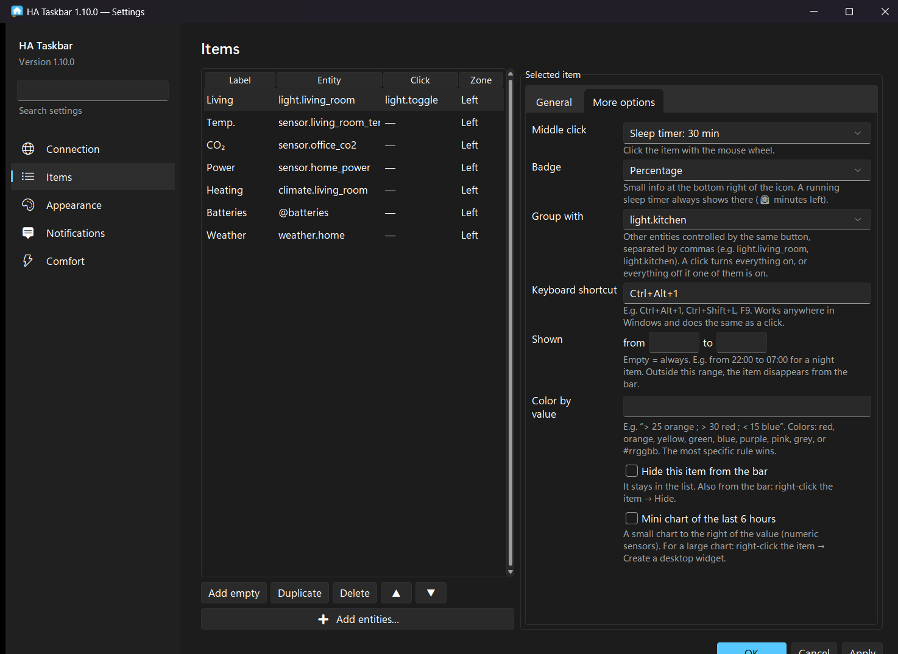

| I want to… | Where | Setting |
|---|---|---|
| Turn off a whole room in one click | More options → **Group with** | `light.kitchen, light.hallway` |
| Turn on a light without leaving my app | More options → **Keyboard shortcut** | `Ctrl+Alt+1` |
| Turn off the light in 30 min with a middle click | More options → **Middle click** | Sleep timer: 30 min |
| Change a ceiling fan's direction (summer / winter) | More options → **Middle click** and **Badge** | Reverse direction, and Direction ↻ ↺ |
| See the brightness or battery on the icon | More options → **Badge** | Percentage, or Battery |
| Show an item only at night | More options → **Shown from … to …** | from `22:00` to `07:00` |
| Put an item away without deleting it | More options → **Hide this item** | (or right-click on the bar → Hide) |
| Show a thermostat's temperature | General → **Displayed value**, **Unit**, **Decimals** | `current_temperature`, `°C`, `1` |
| Set the thermostat to eco in one click | General → **Click action** and **Data (JSON)** | `climate.set_preset_mode` and `{"entity_id": "climate.living_room", "preset_mode": "eco"}` |
| Turn a light on at 30 % in one click | General → **Click action** and **Data (JSON)** | `light.turn_on` and `{"entity_id": "light.living_room", "brightness_pct": 30}` |
| A sensor that does nothing on click | General → **Click action** | (none) — a long press still opens the card |
| Put the item on the right of the bar | General → **Zone** | Right |

The same light, as saved in `config.json`:

```json
{
  "entity_id": "light.living_room",
  "label": "Living",
  "group": ["light.kitchen"],
  "badge": "percentage",
  "middle": "@timer30",
  "hotkey": "Ctrl+Alt+1"
}
```

---

## 📝 Configuration file

Settings are stored in `config.json`, created automatically:
- installed version: `%APPDATA%\HATaskbar\config.json`
- portable version: in its own folder
- from source: next to the script. This file **is not versioned**, since it holds your token (see `.gitignore`).

An example is provided in [`config.example.json`](config.example.json).

Item format:

```json
{
  "entity_id": "climate.thermostat",
  "label": "Heating",
  "card_title": "Living room heating",
  "icon": "flame",
  "attribute": "current_temperature",
  "unit": "°C",
  "decimals": 1,
  "service": "climate.set_preset_mode",
  "data": { "entity_id": "climate.thermostat", "preset_mode": "eco" },
  "zone": "right",
  "middle": "@preset",
  "badge": "percentage",
  "group": ["climate.bedroom"],
  "hotkey": "Ctrl+Alt+1",
  "show_from": "22:00",
  "show_to": "07:00",
  "favorites": [{ "name": "Reading", "brightness_pct": 80, "color_temp_kelvin": 4000 }],
  "cover_positions": [25, 50, 75],
  "thresholds": "> 25 orange ; > 30 red",
  "hidden": false
}
```

The special entity `"@batteries"` is the low battery summary.

`middle` (middle click): `"@card"` (default), `"@direction"`, `"@preset"`, `"@timer30"` (or another number of minutes), `"@mute"`, `"none"` or a service. `badge`: `"direction"`, `"percentage"`, `"battery"` or an attribute name. `favorites` (lights) is filled with “+ Save” on the card.

Notifications (outside `items`):

```json
"notify_offline": true,
"ha_notifications": true,
"quiet_from": "22:00",
"quiet_to": "07:00",
"notifications": [
  { "entity_id": "binary_sensor.front_door", "to": "on", "message": "{name} just opened" }
]
```

Only `entity_id` is required. `icon` can be `"auto"` (default), `"none"`, a key of `ICONS` in [`ha_core.py`](ha_core.py), or an animated icon: `"flame_anim"`, `"fan_anim"`, `"bulb_anim"`, `"eq_anim"`, `"drop_anim"`, `"snow_anim"`, `"sun_anim"`, `"wifi_anim"`, `"bell_anim"`, `"washer_anim"`, `"bolt_anim"`, `"battery_anim"`, `"radar_anim"`, `"heater_anim"`, `"speaker_anim"`, `"timer_anim"`, `"rain_anim"`, `"gear_anim"` (list in [`anim_icons.py`](anim_icons.py)). `service` can be `"none"` to disable the click. `zone` is `"left"` (default) or `"right"`.

Language: `"language": "auto"` (the Windows language), `"fr"` or `"en"`.

Comfort tab options: `"realtime": true`, `"palette_hotkey": "Ctrl+Alt+Space"`, `"compact": false`, `"tooltips": true`, `"flash_changes": true`, `"battery_low": 20`.

The screen is `monitor`: empty for the main screen, otherwise its Windows name (e.g. `"\\\\.\\DISPLAY2"` in the JSON file).

The zone offsets are `offset` (left zone, from the left edge) and `offset_right` (right zone, from the right edge).

---

## 🧠 How it works

Windows 11 no longer allows adding “deskbands” (toolbars) to the taskbar. HA Taskbar works around this:

1. A **small borderless window** per zone (left and right), “always on top”, sits **on top of** the taskbar. It matches its exact height and position, using the Win32 API `FindWindow("Shell_TrayWnd")`.
2. The taskbar comes back to the front on every click, so the window brings itself back on top **as soon as a window becomes active** (`EVENT_SYSTEM_FOREGROUND` hook), and also every 0.4 s.
3. The window is a “tool” and “non-activatable” window: it appears neither in Alt+Tab nor on the taskbar, and doesn't steal focus.
4. A **thread** stays connected to Home Assistant's **WebSocket API** (`/api/websocket`) and subscribes to state changes (`state_changed`), persistent notifications and the `ha_taskbar_notify` event. The WebSocket client is written in pure Python ([`ha_ws.py`](ha_ws.py)) and reconnects on its own. A second thread reads all states at once (`GET /api/states`): regularly without real time, once a minute otherwise, to resynchronize. Clicks call `POST /api/services/<domain>/<service>`. The control card reads the history with `GET /api/history/period/…`, and the weather forecast with the `weather.get_forecasts` service.
5. To avoid flicker, an item is only redrawn when its value changes, and its width never shrinks.
6. **Transparent background**: the background color is declared “transparent” (`-transparentcolor`). Windows then lets clicks pass through transparent pixels. A second, almost invisible window (1 % opacity) just under the bar catches those clicks and passes them to the button under the mouse, so a button's whole rectangle stays clickable.
7. **Language**: texts are written in French in the code and translated through [`i18n.py`](i18n.py) / [`i18n_en.py`](i18n_en.py). The language is chosen at startup from the settings or the Windows UI language.

---

## 📁 Project structure

| File | Role |
|---|---|
| [`ha_taskbar.py`](ha_taskbar.py) | Entry point: the bar (windows, positioning, buttons, refresh) |
| [`card_ui.py`](card_ui.py) | Control card (long press): sliders, switch, modes, history |
| [`settings_ui.py`](settings_ui.py) | Settings window, entity picker, icon picker |
| [`ha_core.py`](ha_core.py) | Shared: config, Home Assistant client, icons, default actions, auto start |
| [`ha_ws.py`](ha_ws.py) | Real-time connection: minimal WebSocket client and Home Assistant event subscriptions |
| [`palette.py`](palette.py) | Command palette (search across all entities) |
| [`tooltip_ui.py`](tooltip_ui.py) | Hover tooltip and its small chart |
| [`widgets_ui.py`](widgets_ui.py), [`history.py`](history.py) | Desktop widgets, and the sensor history shared by widgets and mini charts |
| [`i18n.py`](i18n.py), [`i18n_en.py`](i18n_en.py) | Interface language (Windows' or the chosen one) and English translations |
| [`anim_icons.py`](anim_icons.py) | Animated icons: vector drawing and anti-aliased rendering in pure Python (no dependency) |
| [`ui_theme.py`](ui_theme.py) | Windows 11 look of the windows: light/dark theme, side menu |
| [`sv_ttk/`](sv_ttk/) | rdbende's [Sun Valley](https://github.com/rdbende/Sun-Valley-ttk-theme) theme (MIT license), included as is |
| [`tray.py`](tray.py) | Notification area icon (Windows API, no dependency) |
| [`update_ui.py`](update_ui.py) | Update window: what's new, verified download, installation |
| `config.example.json` | Example configuration |
| `config.json` | Your configuration (created automatically, ignored by git) |
| [`SECURITY.md`](SECURITY.md) | Reporting a security issue |
| [`build.ps1`](build.ps1) | Builds the exe (PyInstaller), the portable zip and the installer (Inno Setup) |
| [`installer/ha_taskbar.iss`](installer/ha_taskbar.iss) | Inno Setup script (French / English): shortcuts, auto start, uninstall |
| [`installer/portable.txt`](installer/portable.txt) | Portable version guide; its presence next to the exe turns that mode on |
| [`assets/`](assets/) | Program icon |
| [`tools/make_icon.py`](tools/make_icon.py) | Generates the icon (`python tools/make_icon.py`) |
| [`tests/`](tests/) | Smoke tests run by GitHub Actions |
| [`macos/`](macos/) | The native macOS version (Swift) |

---

## 🚧 Known limitations

- The buttons show on **one screen** at a time (chosen in the settings).
- With the taskbar set to **auto-hide**, the window doesn't follow the animation.
- With a transparent background, the text edge is smoothed against the “Background” color. Keep a color close to your taskbar's (`#202020` in dark theme, or the light theme for a light taskbar), otherwise a thin outline may appear.
- A Windows update may change how the taskbar behaves.
- Without the real-time connection (turned off, or impossible to establish), HA Taskbar polls Home Assistant at a regular interval: a notification may then arrive up to one interval after the change, and a state that changes and changes back between two reads goes unnoticed.
- The **command palette** only adjusts what the mouse wheel handles (brightness, speed, volume, position, target, numbers). For the rest, Tab opens the card.
- The **sleep timer** is handled by HA Taskbar: if the PC shuts down or the app is closed, the device stays on. For a reliable timer, use the device's own when it has one (it shows under “On the same device”).
- A song's **cover art** isn't shown: Tk can't read JPEG images without an external library.
- Entity names come from your Home Assistant and are shown as they are. Release notes are in French.

---

## 🩺 Troubleshooting

| Symptom | Fix |
|---|---|
| Red **● HA**, “HTTP 401” | Invalid or revoked token: create a new one in Home Assistant |
| “Can't connect” | Check the address (http/https, port 8123) and that the PC can reach Home Assistant |
| Certificate error | Uncheck **Verify the HTTPS certificate** |
| The bar covers icons | Adjust the **offset** of that zone (left or right) in the Appearance tab |
| “HA Taskbar is already running” | An instance is already running: click its icon near the clock (or right-click the bar) → Settings |
| Nothing shows | Run `python ha_taskbar.py` (not `pythonw`) to see errors in the console |

---

## 🍎 HA Taskbar on Mac

HA Taskbar also exists for **macOS 13 or later** (Apple Silicon and Intel). It's a native app: items show in the **menu bar**, at the top right of the screen, and the **panel** opens under the Home icon. Features are the same as on Windows (panel, Assist, timers, cameras, widgets, notifications), except the command palette, global keyboard shortcuts and light favorites. Its interface is in French for now.

### Installation

Paste this command in **Terminal** (Applications → Utilities):

```bash
curl -fsSL https://raw.githubusercontent.com/bbtoff/home-assistant-taskbar/main/macos/install.sh | bash
```

It downloads the latest version from the Releases, checks its SHA-256 hash, installs it in **Applications** and starts it, without the "Apple could not verify…" message (macOS only blocks files downloaded by a browser). The script can be read here: [`macos/install.sh`](macos/install.sh).

- **Updates**: automatic. HA Taskbar checks GitHub at startup and once a day, offers the new version, checks its hash and restarts (🏠 menu → **Mettre à jour**, or **Réglages → Général → Mises à jour**).
- **With the `.dmg`** from the [Releases](https://github.com/bbtoff/home-assistant-taskbar/releases): the app isn't signed by Apple, so macOS blocks it on first launch. Open **System Settings → Privacy & Security**, then **Open Anyway** (once).
- **From Windows**: **Réglages → Général → Importer…** takes your `config.json` (items, icons, thresholds, notifications, widgets).

### Use

- **Menu bar item**: click for the action, hover (0.8 s), long press or ⌥-click for the card, wheel to adjust, right-click for the menu.
- **Panel**: click the Home icon (right-click: the menu). To put an item in it: **Réglages → Éléments → Emplacement → Panneau**, or right-click the item → **Mettre dans le panneau**. Drag its left, right or bottom edge to make it bigger; double-click an edge for the default size.
- **Assist**: in the panel's search field, a sentence of 2 words or more, then **Return** (or ⌘↩).
- **Camera window**: **Réglages → Notifications → Afficher la caméra** on a rule (doorbell…), and **Tester** to try it.
- **Widgets**: **Réglages → Widgets → +**, then right-click a widget for its period, size, icon or logo.

<p align="center">
  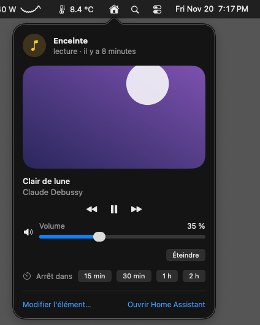
  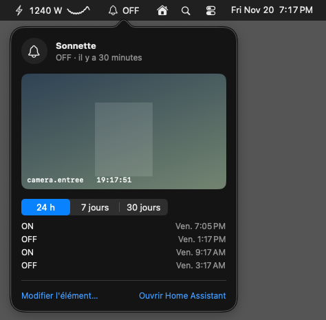
</p>

Details, and how to build the app yourself with Xcode: [macos/README.md](macos/README.md) (in French).

---

## 💬 About this project

I'm not a developer 😄 I brought the ideas, the testing and the feedback along the way. All the technical work (code, installer, documentation and screenshots) was done by **Claude**, Anthropic's AI assistant, from my requests.
