# HA Taskbar

**Français** · [English](README.en.md)

Affiche des **capteurs** et des **boutons Home Assistant** directement sur la **barre des tâches de Windows 11**, dans les zones libres : une **zone à gauche** et une **zone à droite** des icônes, utilisables ensemble.

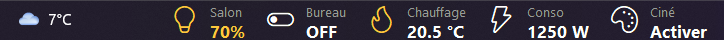

*À gauche : lumière allumée à 70 % (en jaune), prise éteinte et thermostat, à côté du widget météo de Windows. À droite, juste avant les icônes de notification : consommation, température extérieure et scène. Le milieu de la barre des tâches a été retiré de l'image. Les captures utilisent des données de démonstration. D'autres exemples : [Exemples de configuration](#-exemples-de-configuration).*

- 📊 **Valeurs en temps réel** : température, consommation, état d'une lumière…
- 💡 **Boutons cliquables** : allumer/éteindre une lumière ou une prise, lancer une scène ou un script…
- 🧩 **Appui long** sur un élément : une carte de contrôle s'ouvre, comme dans Home Assistant (luminosité, couleur, consigne de chauffage, volume, historique 24 h…)
- ↔️ **Deux zones** : une à gauche et une à droite de la barre des tâches, chaque élément choisit la sienne
- 🎨 Près de 90 icônes Windows 11 qui changent de couleur selon l'état (jaune = allumé), et thème **clair / sombre** qui suit Windows
- 🔥 **18 icônes animées** : flamme qui brûle quand le chauffage chauffe, ventilateur qui tourne, cloche qui sonne, lave-linge, pluie… Lentes et discrètes
- 📊 **Widgets de bureau** : graphiques de tes capteurs (24 h, 7 jours, 30 jours) posés sur le bureau, et mini-courbes dans la barre
- 🔧 Fenêtre de réglages graphique avec aperçu en direct : rien à éditer à la main

<p align="center">
  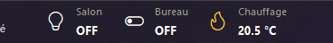
</p>

Un **programme d'installation** et une **version portable** (sans installation) sont fournis : rien d'autre à installer, pas même Python. Depuis les sources, il suffit de Python et de sa bibliothèque standard (tkinter, ctypes, urllib). Le thème des fenêtres est inclus dans le dépôt.

> 🍎 **Nouveau : une version macOS** (aperçu), dans la **barre des menus** du Mac. Installation en une commande dans le Terminal : `curl -fsSL https://raw.githubusercontent.com/bbtoff/home-assistant-taskbar/main/macos/install.sh | bash`. Voir [HA Taskbar sur Mac](#-ha-taskbar-sur-mac).
>
> 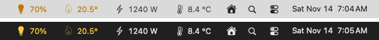

---

## ✨ Nouveautés de la version 1.11

Version Windows. Sur Mac, ces nouveautés arrivent dans une prochaine version.

**🏠 Le panneau** : un seul bouton sur la barre des tâches ouvre la liste de tes éléments, juste au-dessus, comme les Paramètres rapides de Windows 11.
- Les éléments sont **rangés par pièce**. Chaque ligne a une **recherche**, des **interrupteurs**, des **curseurs** (luminosité, volume, position d'un volet…), des boutons **+/−** pour un thermostat, et l'**image des caméras**.
- **Taille réglable** : tire le bord haut, gauche ou droit. Quand le panneau est large, les pièces se répartissent sur **plusieurs colonnes**. Un double-clic sur un bord remet la taille d'origine.
- **Ordre libre** : glisse un élément dans sa pièce, ou le titre d'une pièce pour la déplacer en entier.
- **Opacité** réglable depuis le panneau (bouton ☀ en haut) ou dans **Réglages → Confort → Panneau**.
- Pour y ranger un élément : **Réglages → Éléments → Zone → Panneau**, ou clic droit sur l'élément → **Ranger dans le panneau**. Dans les réglages, la liste des éléments est maintenant séparée en 3 parties (zone gauche, zone droite, panneau), et on glisse un élément de l'une à l'autre.

**⏱️ Minuteurs** (`timer.*`) : le compte à rebours défile sur la barre et dans le panneau. Un clic le met en pause ou le relance. La carte ajoute une barre de progression, les boutons Pause, Annuler et Terminer, et des durées toutes prêtes (1 à 60 min).

**🖼️ Photos et pochettes** : la photo d'une personne et la pochette du morceau en cours s'affichent dans la carte et dans le panneau.

**📷 Caméras**
- **Caméra dans la carte** : **Réglages → Éléments → Plus d'options → Caméra dans la carte** affiche l'image en direct en haut de la carte d'un élément (la caméra de l'entrée sur le bouton du portail, par exemple).
- **Fenêtre caméra quand on sonne** : une notification d'état peut ouvrir une petite fenêtre en bas à droite avec l'image en direct (**Réglages → Notifications → Afficher la caméra**). Elle ne prend pas le clavier, se ferme seule après une minute, et un clic sur l'image ouvre la carte de la caméra.

**💬 Assist dans la palette** : tape une phrase (« allume le salon », « quelle heure est-il ») puis **Entrée** sur la ligne « Demander à Assist », ou **Ctrl+Entrée**. La réponse s'affiche sous la recherche.

**🖥️ Plusieurs écrans** : chaque élément peut s'afficher sur la barre des tâches d'un autre écran (**Réglages → Éléments → Écran**, ou Ctrl + glisser l'élément jusqu'à l'autre barre). Si cet écran est débranché, l'élément revient sur la barre principale.

**Et aussi**
- **Bouton « +N »** : quand la barre manque de place, les éléments qui recouvriraient les icônes de Windows passent dans un menu, au lieu de passer par-dessus (**Réglages → Apparence**).
- **Icône toujours visible** près de l'horloge, au lieu d'être rangée dans « ^ » (**Réglages → Confort**).
- **Saisie d'une entité plus facile** : dans les réglages, une liste de suggestions s'ouvre dès qu'on tape une partie du nom, de la pièce ou de l'identifiant. Si une entité a été renommée dans Home Assistant, HA Taskbar propose la plus proche.
- **Correctif** : dans la liste des éléments des réglages, un clic sur une ligne affiche bien son détail.

## ✨ Nouveautés de la version 1.10

- 🇬🇧 **HA Taskbar parle anglais** (version Windows) : toute l'interface (barre, cartes, palette, réglages, widgets, notifications) est traduite (la version Mac reste en français pour l'instant). La langue suit celle de Windows : français si Windows est en français, anglais sinon. On peut la forcer dans **Réglages → Connexion → Langue**.
- 📖 **README en anglais** : [README.en.md](README.en.md), avec ses propres captures.
- 🧪 Nouvelle section **[Exemples de configuration](#-exemples-de-configuration)** : couleurs selon la valeur prêtes à copier (température, CO₂, consommation, prix de l'électricité…) et recettes pour les options des éléments.
- Le programme d'installation et la version portable sont aussi en anglais sur un Windows anglais.
- 🖼️ **Icône ou logo dans les widgets** : l'icône du capteur, une icône au choix, ou ta propre image (clic droit sur le widget → **Icône** / **Choisir un logo…** ; sur Mac aussi dans **Réglages → Widgets**).
- 🍎 **80 icônes de plus sur Mac** (luminaires, électroménager, énergie, jardin, animaux…) et mini-graphique qui suit la couleur de la barre des menus.

## ✨ Nouveautés de la version 1.9

**📊 Widgets de bureau** (Windows et Mac) : des graphiques de tes capteurs, posés sur le bureau.

<p align="center">
  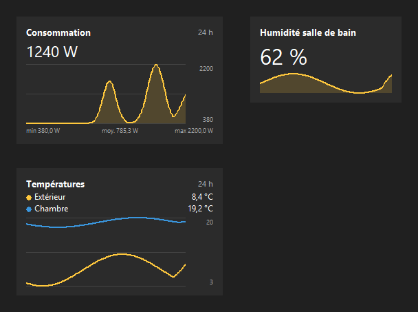
  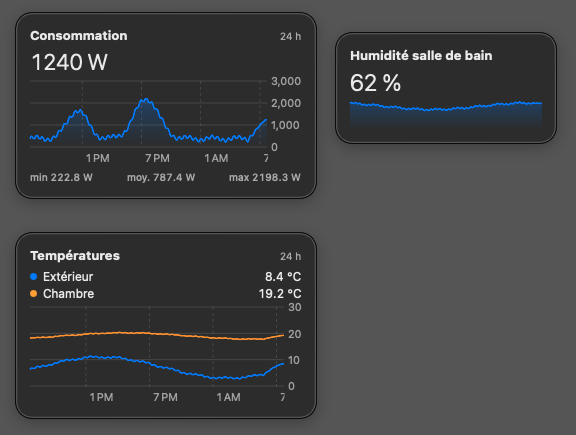
</p>

- 📈 **Graphique sur 24 h, 7 jours ou 30 jours**, avec minimum, moyenne et maximum, ou **valeur en grand** avec sa tendance.
- 🔀 **Plusieurs capteurs sur un même graphique**, chacun avec sa couleur : idéal pour comparer les températures des pièces ou des consommations.
- 🖥️ Ils restent **sur le bureau, sous tes fenêtres** (ou toujours au premier plan), se déplacent à la souris, gardent leur place et se mettent à jour **en temps réel**. Ils suivent le thème clair ou sombre.
- 🖱️ **Clic droit sur un widget** : période, taille (petit, moyen, grand), affichage, ajouter ou retirer un capteur, premier plan, masquer, supprimer.
- ➕ Pour en créer un : **clic droit sur un capteur de la barre → Créer un widget de bureau** (Windows), ou **Réglages → Widgets → +** (Mac). Pour en ajouter un autre au même graphique : clic droit sur un capteur → **Ajouter à un widget**.

**〰️ Mini-graphique dans la barre** : une petite courbe des **6 dernières heures** à côté de la valeur d'un capteur. Clic droit sur l'élément → **Mini-graphique des 6 dernières heures**, ou **Éléments → Plus d'options** (Windows) / **Éléments → Valeur affichée** (Mac).

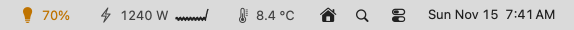

## ✨ Nouveautés de la version 1.8.2

- 🍎 **macOS** : la carte d'une climatisation à plus de 4 modes ne déborde plus (le choix du mode passe dans un menu). Rien ne change sous Windows.

## ✨ Nouveautés de la version 1.8.1

- 🔒 **Jeton d'accès chiffré** : il n'est plus écrit en clair dans `config.json`, mais chiffré avec la protection des données de Windows (DPAPI). Seul ton compte Windows, sur ce PC, peut le relire. Ta configuration actuelle est chiffrée automatiquement au premier lancement. Voir [Le jeton d'accès](#le-jeton-daccès).
- 🍎 **Version macOS** : **installation en une commande** et **mises à jour automatiques**, sans blocage de Gatekeeper ; la carte s'ouvre **au survol** (0,8 s, réglable), appui long plus fiable, nouveau réglage « le clic ouvre la carte » (Réglages → Général), corrections de la carte (curseurs, dates de l'historique).

## ✨ Nouveautés de la version 1.8

**Plus réactif**
- ⚡ **Temps réel** : HA Taskbar reste connecté à Home Assistant (WebSocket). La barre, la carte et les notifications réagissent en **moins d'une seconde**, et un changement bref ne passe plus inaperçu. En cas de coupure, il revient tout seul à l'interrogation régulière.
- ⌨️ **Palette de commandes** (`Ctrl+Alt+Espace`) : une barre de recherche au milieu de l'écran, depuis n'importe quelle application. Tape « salon », **Entrée** pour allumer ou éteindre, **← →** ou la molette pour régler, **Tab** pour la carte. **Toutes** les entités de Home Assistant y sont, même celles qui ne sont pas sur la barre.
- ✋ **Modifier depuis la barre** : clic droit sur un élément → **Modifier cet élément…** ou **Masquer**. **Ctrl + glisser** un élément pour le déplacer ou le changer de zone.

**Plus lisible**
- 💬 **Infobulle au survol** : nom, valeur, « modifié il y a 12 min » et une **mini-courbe des 6 dernières heures** (ou une frise allumé / éteint).
- 🎨 **Couleur selon la valeur** : par exemple `> 25 orange ; > 30 rouge ; < 15 bleu` pour une température, ou un CO₂ en rouge au-dessus de 1000 ppm.
- 🔋 **Icônes qui suivent la valeur** : pile qui se vide, barres du Wi-Fi ou du signal, volume d'un haut-parleur, météo du moment.
- ✨ Une valeur qui change **brille un instant**.
- 🤏 **Barre compacte** : seulement les icônes, la valeur dans l'infobulle.
- 🌦️ **Carte météo** : conditions actuelles et **prévisions sur 5 jours**.

**Plus pratique**
- 🏠 **Choix des entités par pièce** dans « Ajouter des entités… », avec une colonne Pièce.
- 🔔 **Notifications de Home Assistant dans Windows** : les notifications persistantes, et celles envoyées par tes automatisations avec l'événement `ha_taskbar_notify`.
- 🪫 **Résumé des piles faibles** : un seul élément affiche « 3 » piles sous 20 % (ou « OK ») ; sa carte en donne la liste.
- 🔕 **Plage sans notification** (par exemple de 22:00 à 07:00) et **pause** depuis le clic droit (1 h, 3 h, jusqu'à demain 8 h).
- 💾 **Export / import** de tous les réglages, **sans le jeton** : pour sauvegarder, changer de PC ou partager.
- 🔎 **Recherche dans les réglages**, en haut à gauche de la fenêtre.

Les nouvelles options sont dans **Réglages → Confort**, **Réglages → Notifications** et **Éléments → Plus d'options**.

<p>
  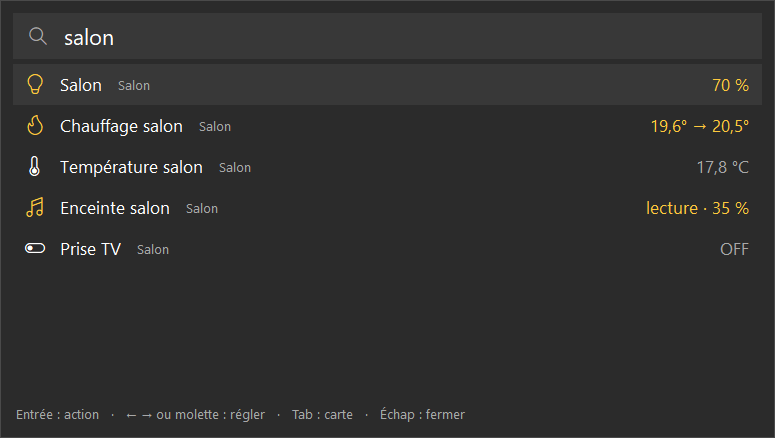
  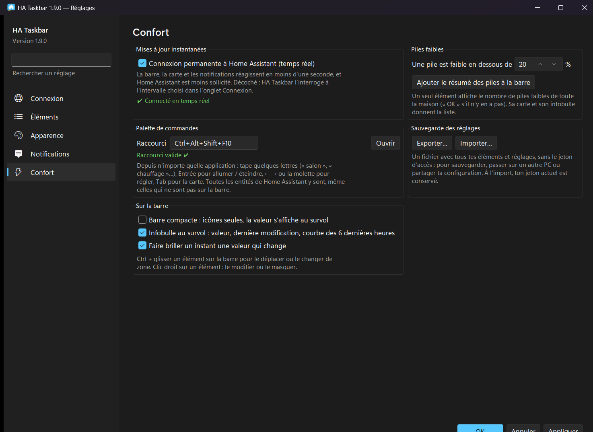
</p>

## ✨ Nouveautés de la version 1.7.1

- 📦 **Version portable** : un simple `.zip` à décompresser, sans installation. Les réglages restent dans son dossier, rien n'est écrit ailleurs sur le PC : le supprimer suffit à tout effacer. Idéal pour essayer HA Taskbar sans rien installer. Voir [Version portable](#version-portable-sans-installation).
- 🔒 **Section [Sécurité et confidentialité](#-sécurité-et-confidentialité)** : ce que fait exactement le programme (connexions, fichiers, jeton), et comment vérifier un téléchargement (empreinte SHA-256, analyse VirusTotal).
- 🪪 **Informations d'identité** dans le programme et l'installateur (éditeur, description, version, dans **Propriétés → Détails**). Elles aident les antivirus à ne pas le prendre pour un programme suspect.

Rien ne change dans l'utilisation : si tu as déjà la 1.7.0 installée, cette mise à jour est facultative.

## ✨ Nouveautés de la version 1.7

**Carte de contrôle (appui long)**
- 🌀 **Ventilateur** : choix du **sens de rotation** (été / hiver), oscillation si l'appareil la gère, modes traduits (Naturel, Nuit, Frais, Auto…). Quand le ventilateur n'a que quelques vitesses (3 à 10), elles s'affichent en boutons **1, 2, 3…** au lieu d'un curseur.
- 🔌 **Sur le même appareil** : la carte montre les autres entités de l'appareil, par exemple la **lumière** d'un ventilateur de plafond, son **minuteur** ou son capteur de température.
- ⏲️ **Arrêt programmé** : 15 min, 30 min, 1 h ou 2 h, pour les lumières, prises, ventilateurs, lecteurs et thermostats. Le temps restant s'affiche sur la carte et en badge sur la barre. Il s'annule depuis la carte ou le menu du clic droit.
- 💡 **Lumières** : ambiances toutes prêtes (Lecture, Détente, Veilleuse) et **favoris** : « + Mémoriser » enregistre la luminosité et la couleur actuelles. Clic droit sur un ★ pour le supprimer.
- 🪟 **Volets** : positions rapides 25 / 50 / 75 %.
- 🌡️ **Thermostat** : humidité et température extérieure (prise dans l'entité météo).
- 🤖 **Aspirateur** : batterie, puissance d'aspiration, bouton « Localiser ».
- 🎵 **Média** : barre de progression du morceau et bouton couper le son.
- 📈 **Historique** sur **24 h, 7 jours ou 30 jours**, avec la moyenne en plus du minimum et du maximum.

**Barre**
- 🖱️ **Molette** sur tous les types : vitesse d'un ventilateur, volume d'un lecteur, position d'un volet, consigne d'un thermostat, valeur d'un nombre, en plus de la luminosité. La valeur s'affiche tout de suite et la commande part à la fin du geste.
- 🖲️ **Clic du milieu** au choix : ouvrir la carte (par défaut), inverser le sens de rotation, mode suivant, arrêt programmé, couper le son, ou n'importe quel service.
- 🏷️ **Badge** sur l'icône : sens de rotation ↻ ↺, pourcentage, batterie ou un attribut.
- 👥 **Groupes** : un élément peut commander plusieurs entités (« tous les ventilateurs »). Le clic allume tout, ou éteint tout si l'une d'elles est allumée, et la barre affiche « 2/3 ».
- ⌨️ **Raccourcis clavier globaux** (ex. Ctrl+Alt+1) : ils font la même chose qu'un clic, depuis n'importe quelle application.
- 🕘 **Plages horaires** : un élément peut n'apparaître que de 22:00 à 07:00, par exemple.
- 🔔 **Notifications Windows** quand une entité change d'état (porte ouverte, machine terminée…), dans la nouvelle page **Réglages → Notifications**. Les entités n'ont pas besoin d'être sur la barre.
- 📡 **Hors ligne** : si Home Assistant ne répond plus, les valeurs passent en gris, « ● HA hors ligne » s'affiche et une notification prévient, puis une autre au retour. Le clic droit indique l'heure de la dernière réponse et propose « Réessayer maintenant ».

## ✨ Nouveautés de la version 1.6

- 🔔 **Icône dans la zone de notification**, à côté de l'horloge : clic gauche pour ouvrir les réglages, clic droit pour le menu. Elle reste accessible même quand aucun élément n'est affiché.
- 🖥️ **Multi-écran** : choisis l'écran qui affiche les boutons dans **Réglages → Apparence → Écran**. Si cet écran est débranché, la barre revient sur l'écran principal. Une application en plein écran sur un autre écran ne masque plus la barre.
- 🐞 **Correction** : HA Taskbar n'a plus de bouton dans la barre des tâches. Il apparaissait avec le fond transparent.

> Windows 11 range parfois les nouvelles icônes dans la flèche **^**. Pour l'avoir toujours visible : glisse-la à côté de l'horloge, ou **Paramètres → Personnalisation → Barre des tâches → Autres icônes de la barre d'état système → HA Taskbar**.

## ✨ Nouveautés de la version 1.5

- 🔥 **13 nouvelles icônes animées**, soit 18 au total. Comme les premières, elles sont immobiles quand l'élément est éteint et bougent lentement quand il est actif :

  <p align="center">
    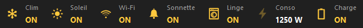<br>
    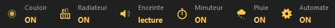
  </p>

  | Icône | Quand elle est active |
  |---|---|
  | ❄️ Flocon | Climatisation, froid : il tourne très lentement |
  | ☀️ Soleil | Les rayons tournent et respirent |
  | 📶 Wi-Fi | Les ondes s'allument l'une après l'autre |
  | 🔔 Cloche | Elle se balance puis fait une pause (sonnette, sirène) |
  | 🧺 Lave-linge | Le linge tourne dans le tambour |
  | ⚡ Éclair | L'énergie monte dans l'éclair (consommation au-dessus de 0) |
  | 🔋 Batterie | En charge : les barres se remplissent |
  | 📡 Détection | Des ondes s'élargissent (mouvement, présence) |
  | ♨️ Radiateur | Des vagues de chaleur montent |
  | 🔊 Haut-parleur | Les ondes sonores battent |
  | ⏲️ Minuteur | L'aiguille tourne (un tour en 6 secondes) |
  | 🌧️ Pluie | Des gouttes tombent du nuage |
  | ⚙️ Engrenage | Il tourne lentement (automatisme, programme en cours) |

  Dans le choix d'icônes, les animations se chargent l'une après l'autre : la fenêtre s'ouvre tout de suite.

## ✨ Nouveautés de la version 1.4

- 🎨 **Réglages redessinés dans le style de Windows 11** : menu à gauche avec icônes, comme les Paramètres de Windows, champs et boutons arrondis, interrupteurs et curseurs modernes.
- 🌗 **Clair ou sombre comme Windows**, barre de titre comprise. Le choix d'icônes, l'ajout d'entités et la fenêtre de mise à jour suivent aussi.

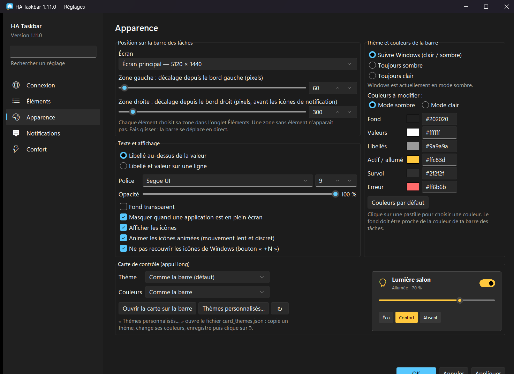

## ✨ Nouveautés de la version 1.3

- ⬆️ **Mises à jour automatiques depuis GitHub** : HA Taskbar vérifie s'il existe une nouvelle version (une minute après le lancement, puis une fois par jour) et propose de l'installer en un clic. Voir [Mises à jour](#-mises-à-jour).

> À partir de la 1.3, plus besoin de télécharger les nouvelles versions à la main. Il faut juste installer cette version-ci une fois.

## ✨ Nouveautés de la version 1.2

- 🔥 **Icônes animées** : immobiles quand l'élément est éteint, elles bougent doucement quand il est allumé. Le rythme est volontairement lent pour ne pas attirer l'œil pendant qu'on travaille.

  <p align="center">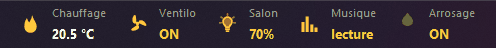</p>

  | Icône | Quand elle bouge |
  |---|---|
  | 🔥 Flamme | Thermostat **en train de chauffer** (pas seulement en mode chauffage). Éteinte, elle n'est plus qu'un contour. |
  | 🌀 Ventilateur | Ventilateur allumé : les pales tournent lentement |
  | 💡 Ampoule | Lumière allumée : le halo et les rayons « respirent » |
  | 🎵 Égaliseur | Lecteur multimédia en lecture |
  | 💧 Goutte | Arrosage ou vanne ouverts, ou capteur au-dessus de 0 (débit…) |

  Elles se choisissent comme les autres icônes (**Réglages → Éléments → Changer…**), et l'option **Animer les icônes animées** de l'onglet Apparence les fige si tu préfères.
- 🎨 **Deux fois plus d'icônes** : près de 90, avec console, ordinateur, téléphone, casque, courrier, calendrier, lever et coucher du soleil, flocon, avion, bus, train, empreinte, clé, outils…

## ✨ Nouveautés de la version 1.1

- ↔️ **Deux zones sur la barre** : une à gauche et une à droite (juste avant les icônes de notification). Chaque élément choisit sa zone dans **Réglages → Éléments → Zone**, et chaque zone a son propre décalage dans **Réglages → Apparence**. Une zone sans élément n'apparaît pas.
- 🔄 **Mise à jour automatique de la configuration** : une barre réglée « côté droit » en 1.0 passe toute seule dans la zone droite, avec le même décalage.
- 🐞 **Correction** : le menu du clic droit s'affiche maintenant devant les capteurs.

Le programme d'installation remplace l'ancienne version et garde tes réglages. Toutes les versions sont sur la page [**Releases**](https://github.com/bbtoff/home-assistant-taskbar/releases).

---

## 📑 Sommaire

1. [Prérequis](#-prérequis)
2. [Installation](#-installation)
3. [Sécurité et confidentialité](#-sécurité-et-confidentialité)
4. [Premier lancement](#-premier-lancement)
5. [Utilisation au quotidien](#-utilisation-au-quotidien)
6. [Les réglages en détail](#-les-réglages-en-détail)
7. [Exemples de configuration](#-exemples-de-configuration)
8. [Fichier de configuration](#-fichier-de-configuration)
9. [Comment ça marche](#-comment-ça-marche)
10. [Structure du projet](#-structure-du-projet)
11. [Limites connues](#-limites-connues)
12. [Dépannage](#-dépannage)
13. [HA Taskbar sur Mac](#-ha-taskbar-sur-mac)

---

## 📋 Prérequis

- **Windows 11** (fonctionne aussi sous Windows 10, avec les icônes Segoe MDL2)
- Uniquement pour lancer depuis les sources : **Python 3.8 ou plus récent** (testé avec 3.10), avec tkinter. C'est le cas par défaut avec l'installeur de python.org.
- Un **Home Assistant** joignable depuis le PC, et un **jeton d'accès longue durée**

### 🔑 Créer le jeton d'accès Home Assistant

1. Dans Home Assistant, clique sur **ton profil** (en bas à gauche).
2. Ouvre l'onglet **Sécurité**.
3. Tout en bas, dans **Jetons d'accès longue durée**, clique sur **Créer un jeton**.
4. Donne-lui un nom (par exemple « HA Taskbar ») puis copie le jeton. Il ne sera plus affiché ensuite.

---

## 📦 Installation

### Avec le programme d'installation (recommandé)

1. Télécharge `HATaskbar-Setup-<version>.exe` depuis la page [**Releases**](https://github.com/bbtoff/home-assistant-taskbar/releases) du dépôt.
2. Lance-le. Aucun droit administrateur n'est demandé : le programme s'installe pour ton compte, dans `%LOCALAPPDATA%\Programs\HA Taskbar`.
3. Options proposées : **lancer au démarrage de Windows** (cochée) et **icône sur le Bureau**.

Une fois installé, HA Taskbar apparaît dans le menu Démarrer et se désinstalle depuis **Paramètres → Applications → Applications installées**. La désinstallation propose aussi d'effacer les réglages, jeton compris.

Pour une mise à jour, lance simplement le nouveau programme d'installation : il ferme HA Taskbar, remplace les fichiers et garde tes réglages.

> Le programme n'est pas signé numériquement : au premier lancement, Windows SmartScreen peut afficher « Windows a protégé votre PC ». Clique sur **Informations complémentaires**, puis **Exécuter quand même**. Pour vérifier le fichier avant, voir [Sécurité et confidentialité](#-sécurité-et-confidentialité).

### Version portable (sans installation)

Pour essayer HA Taskbar sans rien installer :

1. Télécharge `HATaskbar-Portable-<version>.zip` depuis la page [**Releases**](https://github.com/bbtoff/home-assistant-taskbar/releases).
2. Décompresse-le dans un dossier où tu peux écrire : Documents, Bureau, clé USB… (pas dans `Program Files`).
3. Lance `HATaskbar.exe` dans le dossier `HA Taskbar`.

Tes réglages, jeton compris (chiffré pour ton compte Windows), restent dans ce dossier (`config.json`) : rien n'est écrit dans `%APPDATA%`, ni dans le registre, sauf si tu coches **Lancer au démarrage de Windows**. Pour tout supprimer, décoche cette case si besoin, quitte HA Taskbar et supprime le dossier. C'est le fichier `portable.txt` qui active ce mode : ne le supprime pas.

La version portable signale les nouvelles versions, mais ne se met pas à jour toute seule : télécharge le nouveau `.zip` et remplace le contenu du dossier en gardant ton `config.json`.

Comme pour le programme d'installation, Windows SmartScreen peut afficher un avertissement au premier lancement.

### Depuis les sources

```powershell
git clone https://github.com/bbtoff/home-assistant-taskbar.git
cd home-assistant-taskbar
pythonw ha_taskbar.py
```

`pythonw` lance le programme sans fenêtre de console. Pour voir les éventuelles erreurs, utilise `python` à la place.

### Construire le programme d'installation

```powershell
winget install -e --id JRSoftware.InnoSetup --scope user   # une seule fois
powershell -ExecutionPolicy Bypass -File build.ps1
```

`build.ps1` installe PyInstaller dans un environnement virtuel dédié (`%LOCALAPPDATA%\HATaskbar-build`) et crée `HATaskbar.exe`. Il en fait la version portable `dist\HATaskbar-Portable-<version>.zip`, puis le passe à Inno Setup, qui produit `dist\HATaskbar-Setup-<version>.exe`. Il affiche à la fin l'empreinte SHA-256 des deux fichiers. Le numéro de version vient de `__version__` dans [`ha_core.py`](ha_core.py).

### 🔄 Mises à jour

Quand une nouvelle version est publiée sur la page [Releases](https://github.com/bbtoff/home-assistant-taskbar/releases), une petite fenêtre s'ouvre avec ses nouveautés :

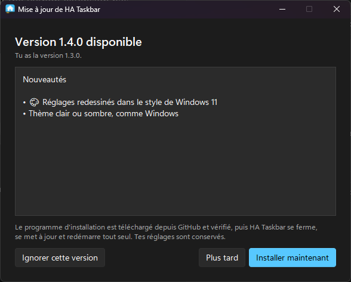

- **Installer maintenant** : le programme d'installation est téléchargé depuis GitHub, puis **vérifié** (taille exacte et empreinte SHA-256 publiée par GitHub). HA Taskbar se ferme, se met à jour et redémarre tout seul. Tes réglages sont conservés.
- **Plus tard** : la fenêtre se ferme, et le clic droit sur la barre propose **Mettre à jour vers la version…** tant que ce n'est pas fait.
- **Ignorer cette version** : plus de rappel pour cette version-là, seulement pour la suivante.

À tout moment : clic droit → **Rechercher une mise à jour**, ou **Réglages → Connexion → Rechercher maintenant**. La recherche automatique se désactive dans ce même onglet.

La recherche interroge l'API publique de GitHub, sans compte ni jeton, et n'envoie aucune information sur toi ou ta maison. Depuis les sources (`python ha_taskbar.py`), la fenêtre propose seulement d'ouvrir la page de la version.

---

## 🔒 Sécurité et confidentialité

HA Taskbar est un projet personnel, au code entièrement ouvert. Voici exactement ce qu'il fait, pour que tu puisses l'installer en connaissance de cause.

### Ce qui sort de ton PC

| Destination | Pourquoi | Ce qui est envoyé |
|---|---|---|
| **Ton Home Assistant**, à l'adresse saisie dans les réglages | Lire les états, l'historique et les pièces, recevoir les changements en temps réel, envoyer les commandes que tu déclenches | Ton jeton d'accès, les commandes |
| **api.github.com** et **github.com** | Rechercher et télécharger les mises à jour (désactivable dans **Réglages → Connexion**) | Rien d'autre que le numéro de version d'HA Taskbar |

C'est tout : **pas de télémétrie**, pas de statistiques, pas de publicité, pas de compte à créer. Le lien **Ouvrir dans Home Assistant** d'une carte ouvre simplement ton navigateur.

### Le jeton d'accès

- Il est **chiffré** dans `config.json` (`%APPDATA%\HATaskbar\` pour la version installée, à côté du programme pour la version portable et les sources), avec la **protection des données de Windows** (DPAPI). Seul ton compte Windows, sur ce PC, peut le déchiffrer : le fichier ne contient plus le jeton en clair (clé `token_protected`), et une copie du fichier ne suffit pas à le relire sur un autre ordinateur.
- Les anciennes configurations, avec le jeton en clair, sont chiffrées automatiquement au premier lancement.
- Un programme qui tourne **sous ton compte**, sur ce PC, peut quand même demander à Windows de le déchiffrer : c'est la limite de toute application qui doit se reconnecter seule, sans te demander de mot de passe.
- Sur un autre PC ou un autre compte Windows (version portable copiée sur une clé USB, par exemple), le jeton ne peut pas être déchiffré : HA Taskbar te demande simplement de le coller à nouveau.
- Crée un **jeton dédié** nommé « HA Taskbar » : en cas de doute, tu le supprimes dans Home Assistant (**profil → Sécurité**) sans toucher à tes autres accès.
- La désinstallation propose d'effacer les réglages, jeton compris.
- Laisse **Vérifier le certificat HTTPS** coché (**Réglages → Connexion**). Décoche-le seulement pour un Home Assistant en HTTPS avec un certificat auto-signé, sur ton réseau local.

### Ce qui est modifié sur ton PC

Avec le programme d'installation :

- Le dossier du programme : `%LOCALAPPDATA%\Programs\HA Taskbar`
- Le dossier des réglages : `%APPDATA%\HATaskbar`
- Une seule valeur du registre, `HATaskbar` dans `HKCU\Software\Microsoft\Windows\CurrentVersion\Run`, si le lancement au démarrage est coché

Avec la [version portable](#version-portable-sans-installation), seulement son propre dossier, plus la valeur du registre si tu coches le lancement au démarrage.

Aucun droit administrateur, aucun service, aucun pilote. Les mises à jour automatiques n'installent que le programme d'installation publié dans les [Releases](https://github.com/bbtoff/home-assistant-taskbar/releases) de ce dépôt, après avoir vérifié sa taille et son empreinte SHA-256.

### Vérifier le programme d'installation

1. **Empreinte SHA-256** : elle est indiquée dans les notes de chaque version, et à côté du fichier sur la page Releases. Pour la comparer, dans PowerShell :
   ```powershell
   Get-FileHash .\HATaskbar-Setup-1.7.1.exe
   ```
   Majuscules ou minuscules, peu importe : les 64 caractères doivent être identiques.
2. **Analyse VirusTotal** : chaque version donne le lien de son rapport (par exemple [celui de la 1.7.0](https://www.virustotal.com/gui/file/fc9aa967ec70136170b0f20e3b1fb22be36b73e6a594a49a870e022d4e8a6001)). Les programmes construits avec PyInstaller sont parfois signalés à tort par quelques antivirus peu connus (souvent 1 à 5 sur plus de 70) : c'est un faux positif connu, dû au lanceur que PyInstaller ajoute à tous les programmes Python.
3. **Sans rien installer** : la [version portable](#version-portable-sans-installation) se supprime avec son dossier.
4. **Sans faire confiance au fichier .exe** : tu peux [lancer HA Taskbar depuis les sources](#depuis-les-sources), ou [construire toi-même le programme d'installation](#construire-le-programme-dinstallation) avec `build.ps1`.

Pour signaler un problème de sécurité, voir [SECURITY.md](SECURITY.md).

---

## 🚀 Premier lancement

Au premier lancement, la fenêtre de **Réglages** s'ouvre toute seule :

1. **Onglet Connexion** : saisis l'adresse de Home Assistant (ex. `http://homeassistant.local:8123`) et colle le jeton, puis clique sur **Tester la connexion**. Le nom et la version de ton Home Assistant s'affichent, ainsi que le nombre d'entités.

   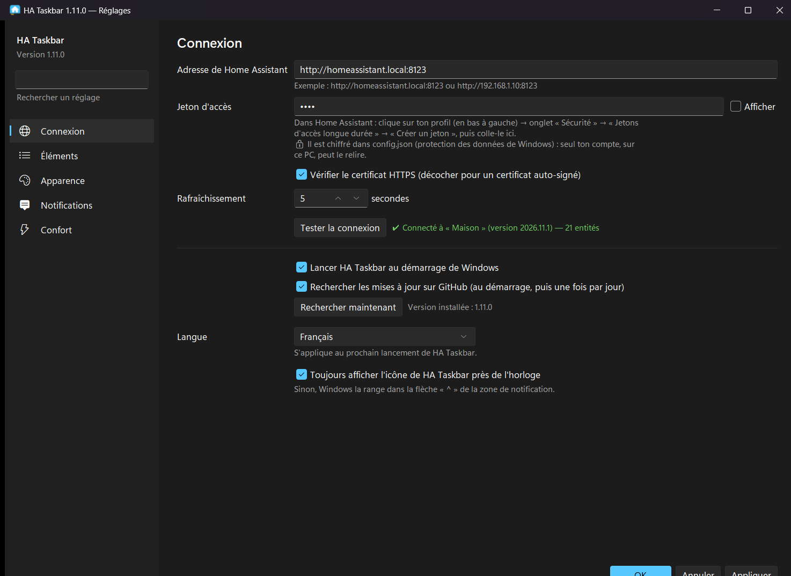

2. **Onglet Éléments** : clique sur **➕ Ajouter des entités…**, cherche tes entités (par nom ou par type), puis double-clique pour les ajouter à la barre.

   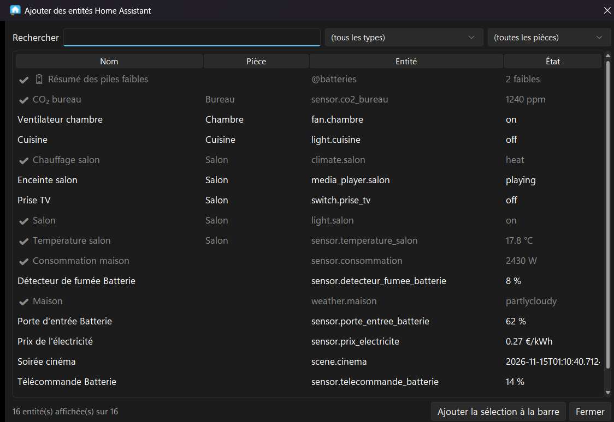

3. Clique sur **OK**. La barre apparaît sur la barre des tâches.

Pour lancer HA Taskbar à chaque démarrage, coche **Lancer HA Taskbar au démarrage de Windows** dans l'onglet Connexion.

---

## 👆 Utilisation au quotidien

| Action | Effet |
|---|---|
| **Clic** sur un bouton | Action selon le type : allume/éteint une lumière, une prise ou un ventilateur, lance une scène ou un script, appuie sur un bouton… |
| **Appui long** (½ seconde) | Ouvre la [carte de contrôle](#-carte-de-contrôle-appui-long) de l'élément |
| **Clic** sur un capteur | Ouvre directement sa carte, puisqu'un capteur n'a pas d'action |
| **Molette** | Luminosité d'une lumière, vitesse d'un ventilateur, volume d'un lecteur, position d'un volet, consigne d'un thermostat, valeur d'un nombre |
| **Clic du milieu** (molette) | Ouvre la carte, ou l'action choisie dans **Réglages → Éléments → Plus d'options** |
| **Raccourci clavier** | L'action du clic, depuis n'importe quelle application (à définir par élément) |
| **Survol** | Infobulle : valeur, dernière modification, courbe des 6 dernières heures |
| **Ctrl + glisser** un élément | Le déplace sur la barre, ou dans l'autre zone |
| **Clic droit** sur un élément | Le modifier, ouvrir sa carte, le masquer |
| **Clic droit** n'importe où | Menu : palette de commandes, éléments masqués, suspendre les notifications, Réglages…, Rafraîchir, Quitter |
| **Ctrl+Alt+Espace** | [Palette de commandes](#️-palette-de-commandes) |
| **Icône près de l'horloge** | Clic gauche : réglages. Clic droit : le même menu |
| **● HA hors ligne** en rouge | Home Assistant ne répond pas : les valeurs sont grisées. Clic droit pour voir l'erreur et réessayer, clic gauche pour ouvrir les réglages. |

La barre se masque automatiquement quand une application passe en plein écran (jeu, vidéo).

### ⌨️ Palette de commandes

`Ctrl+Alt+Espace` (modifiable dans **Réglages → Confort**) ouvre une barre de recherche au milieu de l'écran, quelle que soit l'application active. Elle cherche dans **toutes** les entités de Home Assistant, par nom, identifiant ou pièce, sans tenir compte des accents. Les éléments de ta barre et les entités pilotables passent en premier.

| Touche | Effet |
|---|---|
| **Entrée** ou clic | Action : allume / éteint, lance la scène… (ouvre la carte pour un capteur ou un thermostat) |
| **← →** ou molette | Règle : luminosité, vitesse, volume, position, consigne |
| **Tab** | Ouvre la carte de l'entité |
| **↑ ↓** | Change de ligne |
| **Échap** | Ferme (un 2e appui sur le raccourci aussi) |
| **Ctrl+Entrée** | Envoie la phrase tapée à **Assist**, l'assistant de Home Assistant. La réponse s'affiche sous la recherche, et la conversation continue tant que la palette reste ouverte. |


### 💬 Infobulle

Au survol d'un élément, une infobulle donne son nom complet, sa valeur, l'heure de son dernier changement et une courbe des 6 dernières heures (ou une frise allumé / éteint) :

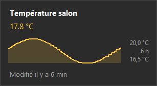

### 🧩 Carte de contrôle (appui long)

Un appui long sur un élément ouvre une carte juste au-dessus de la barre des tâches, dans l'esprit de la fenêtre de détail de Home Assistant. Son contenu dépend du type d'entité :

<p align="center">
  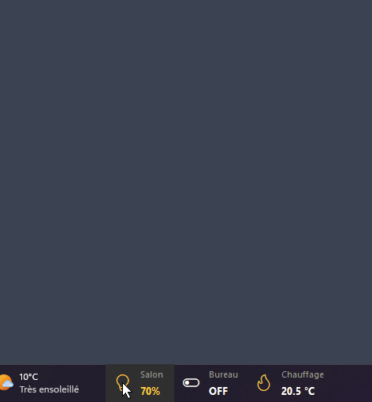
</p>

<p>
  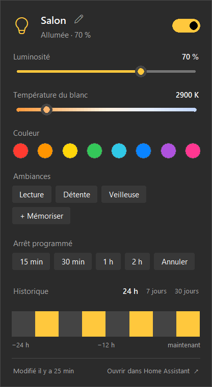
  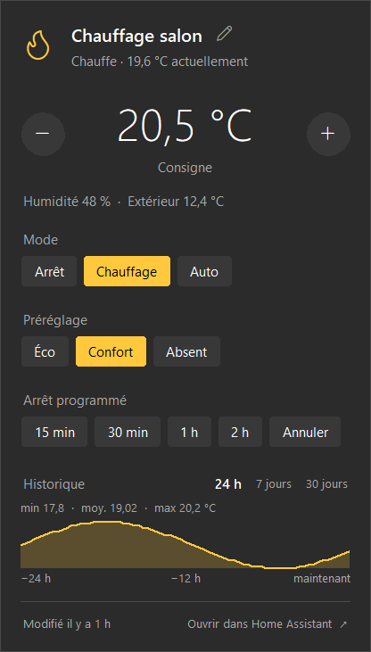
  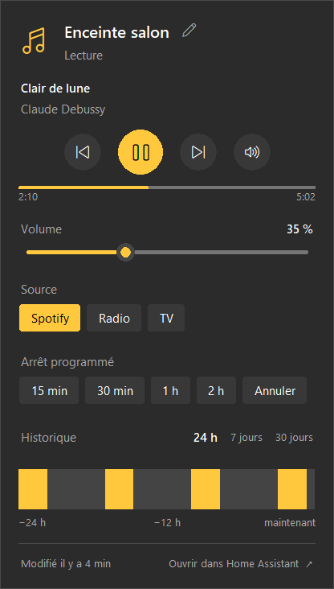
  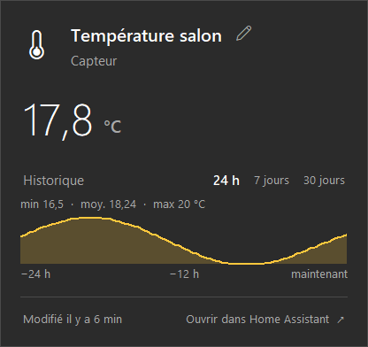
  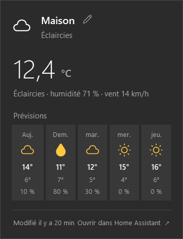
</p>

| Type d'entité | Contenu de la carte |
|---|---|
| Lumière | Interrupteur, luminosité, température du blanc et couleurs, selon ce que gère l'ampoule. Ambiances et favoris mémorisés |
| Thermostat | Consigne avec − / + (ou molette), humidité et température extérieure, modes (arrêt, chauffage, auto…) et préréglages (éco, confort…) |
| Volet | Ouvrir / Stop / Fermer, position avec raccourcis 25 / 50 / 75 %, inclinaison |
| Lecteur multimédia | Titre et artiste, précédent / lecture-pause / suivant, couper le son, progression, volume, source |
| Ventilateur | Interrupteur, vitesse (curseur, ou boutons 1, 2, 3… s'il a peu de vitesses), modes, sens de rotation, oscillation |
| Aspirateur | Démarrer / Pause / Base / Localiser, batterie, puissance d'aspiration |
| Groupe | Un interrupteur par membre (et la luminosité des lumières) |
| Météo | Température, conditions, humidité, vent et prévisions sur 5 jours |
| Résumé des piles | Les piles sous le seuil, de la plus vide à la moins vide |
| Prise, interrupteur, automatisation | Interrupteur |
| Serrure | Verrouiller / Déverrouiller |
| Nombre, liste de choix | Curseur ou boutons de choix |
| Scène, script, bouton | Bouton d'activation |
| Capteur et autres | Valeur en grand |

Les lumières, prises, ventilateurs, lecteurs et thermostats ont un **arrêt programmé** (15 min à 2 h). C'est HA Taskbar qui éteint l'appareil à l'heure dite : il doit donc rester lancé.

Quand l'entité fait partie d'un appareil qui en a d'autres (la lumière d'un ventilateur de plafond, son minuteur, un capteur…), la carte les montre dans **Sur le même appareil**, avec leur commande.

Toutes les cartes, sauf celles des scènes, scripts et boutons, affichent l'**historique** sur 24 h, 7 jours ou 30 jours (Home Assistant garde 10 jours par défaut). C'est une courbe pour une valeur numérique, avec minimum, moyenne et maximum, ou une frise colorée pour un état allumé/éteint. Au survol, la valeur et l'heure s'affichent. Le lien **Ouvrir dans Home Assistant** ouvre l'historique complet dans le navigateur.

Les curseurs n'envoient la commande qu'au relâchement de la souris, pour ne pas inonder Home Assistant de requêtes. La consigne du thermostat est envoyée 0,7 s après le dernier clic sur − / +.

Le **titre** de la carte se change avec le crayon **✎** à côté (ou un double-clic dessus). **Entrée** enregistre et **Échap** annule. Un titre vide remet le nom de l'entité dans Home Assistant. Le titre est enregistré dans ta config (`card_title`) et se modifie aussi dans l'onglet Éléments des réglages. Il ne change rien dans Home Assistant.

La carte se ferme avec **Échap**, ou par un clic n'importe où en dehors.

#### 🎨 Thèmes de la carte

Dans **Réglages → Apparence → Carte de contrôle**, choisis un thème et ses couleurs (comme la barre, toujours sombre ou toujours clair). Un aperçu se met à jour à chaque changement, et le bouton **Ouvrir la carte sur la barre** montre le vrai résultat.

<p>
  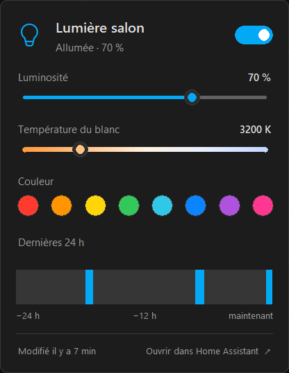
  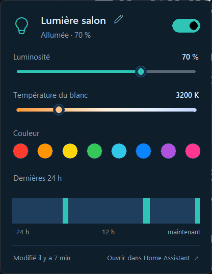
  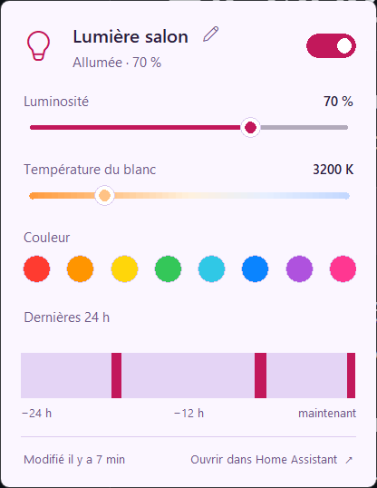
  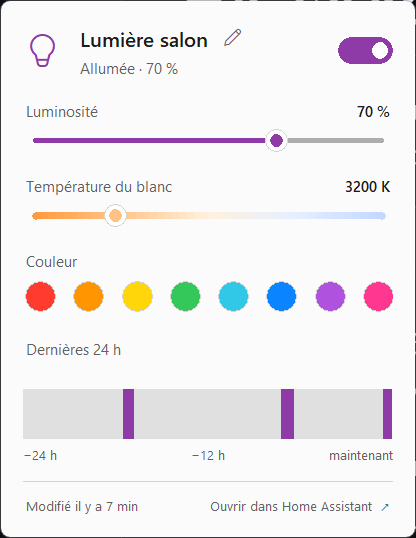
</p>

| Thème | Particularité |
|---|---|
| Comme la barre (défaut) | Gris neutre, accent = couleur « Actif / allumé » de la barre |
| Windows 11 | Gris neutre, accent = couleur d'accentuation choisie dans Windows |
| Home Assistant | Couleurs de l'interface de Home Assistant, boutons très arrondis |
| Océan, Forêt, Crépuscule | Ambiances colorées |
| Contraste élevé | Noir/blanc et jaune ou bleu vif, angles droits |

Chaque thème existe en version **sombre** et **claire**.

**Créer ses propres thèmes** : le bouton **Thèmes personnalisés…** crée et ouvre `card_themes.json`, placé dans le même dossier que `config.json`. Il contient un exemple à copier :

```json
{
  "mon_theme": {
    "name": "Mon thème",
    "radius": 8,
    "dark":  { "bg": "#0f1e2b", "surface": "#17304a", "surface_h": "#1f3d5c", "border": "#24486b",
               "fg": "#e6f1ff", "dim": "#8aa4bf", "knob": "#17304a", "accent": "#2ec4b6" },
    "light": { "bg": "#f2f8fc", "surface": "#dcebf5", "surface_h": "#cde1ef", "border": "#c2d8e8",
               "fg": "#0f2a3f", "dim": "#4f6b82", "knob": "#ffffff", "accent": "#0f8b8d" }
  }
}
```

| Clé | Rôle |
|---|---|
| `bg` | Fond de la carte |
| `surface` / `surface_h` | Fond des boutons, au repos et au survol |
| `border` | Contour de la carte |
| `fg` / `dim` | Texte principal / texte secondaire |
| `knob` | Bouton rond des curseurs |
| `accent` | Couleur active (curseurs, interrupteur, choix sélectionné). `"bar"` reprend la couleur de la barre, `"system"` celle de Windows. |
| `radius` | Arrondi des boutons, en pixels (0 à 16) |

Une clé absente reprend la valeur du thème par défaut. Après avoir enregistré le fichier, clique sur **↻** pour recharger la liste.

---

## 🔧 Les réglages en détail

### Onglet Connexion
- **Adresse** et **jeton** de Home Assistant
- **Vérifier le certificat HTTPS** : à décocher pour un certificat auto-signé
- **Rafraîchissement** : intervalle de lecture des états, en secondes (5 par défaut). Après un clic, la mise à jour est immédiate.
- **Lancer au démarrage de Windows** : ajoute ou retire l'entrée `HATaskbar` dans `HKCU\Software\Microsoft\Windows\CurrentVersion\Run`
- **Langue** : automatique (celle de Windows), français ou anglais. Après un changement, HA Taskbar propose de redémarrer.

### Onglet Éléments

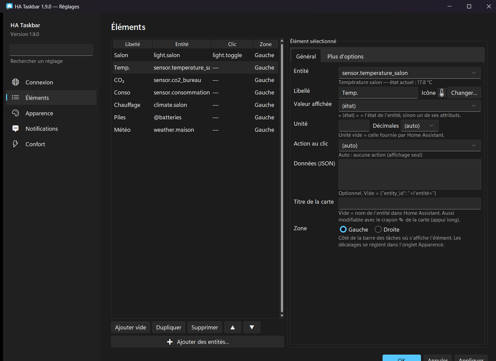

- **Ajouter des entités…** : parcourt toutes les entités, avec une recherche multi-mots et un filtre par type. Les entités déjà présentes sont grisées (✔).
- **▲ ▼** pour l'ordre, **Dupliquer**, **Supprimer**. La liste a 3 parties (**zone gauche**, **zone droite**, **panneau**) : glisse un élément pour le changer de place ou de partie.
- Pour chaque élément :
  - **Entité** : une liste de suggestions s'ouvre dès qu'on tape une partie du nom, de la pièce ou de l'identifiant (↑ ↓ puis Entrée)
  - **Zone** : gauche, droite ou **panneau**, et **Écran** si tu en as plusieurs
  - **Libellé** et **Icône** : automatique selon le type, au choix parmi plus de 100 (dont 18 animées), ou aucune
  - **Valeur affichée** : l'état de l'entité ou un de ses attributs (ex. `current_temperature` d'un thermostat)
  - **Unité** et **Décimales**
  - **Action au clic** : automatique, aucune, ou n'importe quel service (ex. `light.turn_on`)
  - **Données (JSON)** : paramètres envoyés au service (ex. `{"entity_id": "light.salon", "brightness_pct": 30}`)
  - **Titre de la carte** : titre affiché sur la carte d'appui long. Vide = nom de l'entité dans Home Assistant.
- Onglet **Plus d'options** de chaque élément :
  - **Clic du milieu** : ouvrir la carte (par défaut), inverser le sens de rotation, mode suivant, arrêt programmé, couper le son, rien, ou un service
  - **Badge** : petite info en bas à droite de l'icône (sens de rotation, pourcentage, batterie ou un attribut). Un arrêt programmé en cours s'y affiche toujours.
  - **Grouper avec** : autres entités commandées par le même bouton
  - **Raccourci clavier** : par exemple `Ctrl+Alt+1`, `Ctrl+Maj+L` ou `F9`. Si une autre application utilise déjà la combinaison, le menu du clic droit le signale.
  - **Affiché de … à …** : plage horaire d'affichage, qui peut passer minuit (22:00 → 07:00)
  - **Couleur selon la valeur** : règles séparées par `;`, comme `> 25 orange ; > 30 rouge ; < 15 bleu`. Couleurs : rouge, orange, jaune, vert, bleu, violet, rose, gris, ou `#rrggbb`. Quand plusieurs règles conviennent, la plus précise gagne (30 l'emporte sur 25).
  - **Masquer cet élément de la barre** : il reste dans la liste, pour le réafficher plus tard (aussi depuis le clic droit sur la barre)

Le bouton **Changer…** à côté de l'icône ouvre le choix parmi près de 90 icônes Windows 11. Les **icônes animées** sont en bas, et s'animent dans la fenêtre pour donner un aperçu :

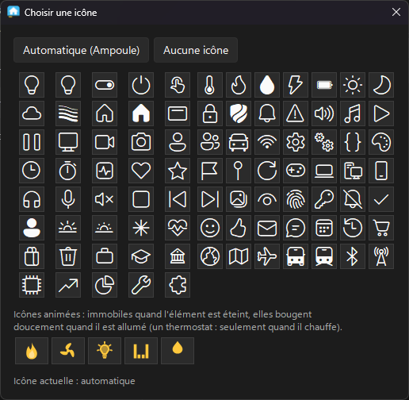

Actions automatiques au clic :

| Type d'entité | Action |
|---|---|
| `light`, `switch`, `input_boolean`, `fan`, `cover`, `automation` | `toggle` |
| `script`, `scene` | `turn_on` |
| `button`, `input_button` | `press` |
| `media_player` | `media_play_pause` |
| `sensor`, `binary_sensor`, … | aucune (affichage seul) |
| groupe (« Grouper avec ») | tout allumer, ou tout éteindre si l'un est allumé |

Pour les scènes, boutons et scripts, la barre affiche « Activer », « Appuyer » ou « Lancer » à la place de l'état. Home Assistant y met en effet la date du dernier déclenchement, ce qui n'a pas d'intérêt ici.

### Onglet Apparence


- **Écran** (multi-écran) : l'écran sur lequel s'affichent les boutons. Windows doit afficher la barre des tâches sur cet écran (*Paramètres → Personnalisation → Barre des tâches → Comportements de la barre des tâches → Afficher ma barre des tâches sur tous les écrans*).
- **Position** : la barre a deux zones, une à **gauche** et une à **droite** (juste avant les icônes de notification). Chacune a son **décalage** en pixels depuis son bord, et le curseur la déplace en direct. Chaque élément choisit sa zone dans l'onglet Éléments (champ **Zone**), et une zone sans élément n'apparaît pas.
- **Disposition** : libellé au-dessus de la valeur, ou les deux sur une ligne :

  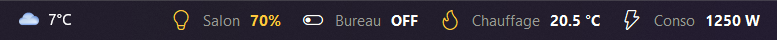
- **Thème de la barre** : **Suivre Windows** (par défaut), **Toujours sombre** ou **Toujours clair**. La barre a deux jeux de couleurs, un pour le mode sombre et un pour le mode clair. Elle bascule toute seule, en 2 secondes environ, quand tu changes le mode de Windows dans *Paramètres → Personnalisation → Couleurs*. Le choix « Couleurs à modifier » indique quel jeu tu édites.
- **Fond transparent** (activé par défaut) : on voit le fond de la barre des tâches de Windows derrière les boutons. Comme les icônes de Windows restent visibles à travers, garde la barre dans une zone libre. Le survol affiche un rectangle de la couleur « Survol ».
- **Police**, **taille**, **opacité**, **afficher les icônes**, **animer les icônes animées**, **masquer en plein écran**
- **Couleurs** : fond, valeurs, libellés, actif/allumé, survol, erreur, pour chacun des deux modes. Le bouton **Couleurs par défaut** remet celles d'origine.
- **Carte de contrôle** : thème et couleurs de la carte d'appui long (voir [Thèmes de la carte](#-thèmes-de-la-carte)).

### Onglet Notifications

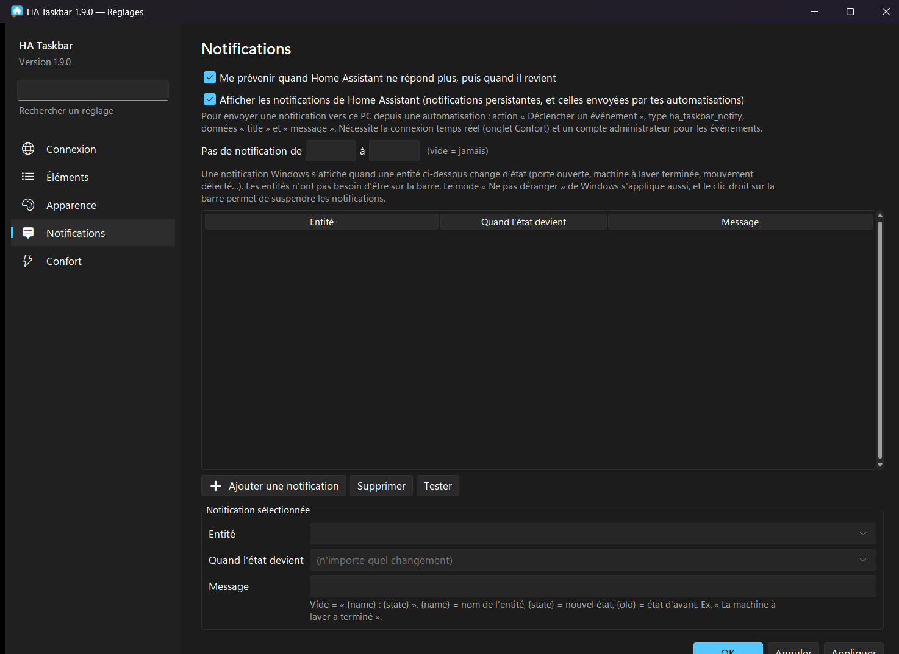

- **Me prévenir quand Home Assistant ne répond plus** : une notification à la perte de connexion, une autre au retour
- **Afficher les notifications de Home Assistant** : les notifications persistantes (mise à jour disponible, nouvel appareil…) et celles de tes automatisations. Pour en envoyer une vers le PC, ajoute à une automatisation l'action **Déclencher un événement** :
  ```yaml
  action: event
  event: ha_taskbar_notify
  event_data:
    title: Machine à laver
    message: Le cycle est terminé
  ```
  Il faut la connexion temps réel (onglet Confort). Recevoir ces événements demande un jeton créé avec un compte **administrateur**.
- **Pas de notification de … à …** : plage horaire silencieuse, qui peut passer minuit. Le clic droit sur la barre permet aussi de **suspendre** les notifications (1 h, 3 h, jusqu'à demain 8 h), et le mode **Ne pas déranger** de Windows s'applique.
- **Notifications d'état** : choisis une entité, éventuellement l'état qui déclenche (`on`, `open`, `off`…), et un message. Dans le message, `{name}` est le nom de l'entité, `{state}` son nouvel état et `{old}` l'état d'avant. **Afficher la caméra** ouvre en plus une fenêtre avec l'image en direct, par exemple quand on sonne. **Tester** affiche la notification tout de suite.

Les notifications apparaissent comme celles des autres applications, et dans le centre de notifications de Windows.

### Onglet Confort


- **Mises à jour instantanées** : connexion permanente à Home Assistant. L'état de la connexion s'affiche dessous. Décoché, HA Taskbar interroge Home Assistant à l'intervalle de l'onglet Connexion.
- **Palette de commandes** : son raccourci (vide = seulement depuis le menu du clic droit), et un bouton pour l'essayer.
- **Panneau** : titre, valeur affichée sur le bouton, zone du bouton, regroupement par pièce et opacité.
- **Sur la barre** : barre compacte (icônes seules), infobulle au survol, valeur qui brille quand elle change.
- **Piles faibles** : le seuil (20 % par défaut), et un bouton qui ajoute le résumé des piles à la barre.
- **Sauvegarde** : **Exporter…** écrit un fichier avec tous tes réglages, sans le jeton d'accès. **Importer…** les remplace, en gardant ton jeton.

La case **Rechercher un réglage**, en haut à gauche de la fenêtre, trouve une option dans toutes les pages et l'affiche.

Tous les changements sont **prévisualisés en direct** sur la barre. **Appliquer**/**OK** enregistre, **Annuler** revient à l'état précédent.

---

## 🧪 Exemples de configuration

Sur cette barre de démonstration, chaque élément montre une possibilité différente :

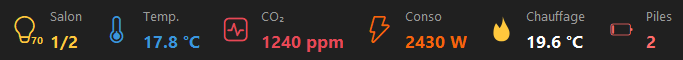

| Élément | Réglage | Ce qu'on voit |
|---|---|---|
| **Salon** (`light.salon`) | **Grouper avec** `light.cuisine`, **Badge** Pourcentage, **Clic du milieu** Arrêt programmé dans 30 min, **Raccourci** `Ctrl+Alt+1` | « 1/2 » : une lumière allumée sur les deux, et le petit « 70 » sur l'icône est sa luminosité |
| **Temp.** | **Couleur selon la valeur** `< 19 bleu ; > 24 orange ; > 26 rouge` | 17,8 °C : bleu, il fait frais |
| **CO₂** | `> 800 orange ; > 1200 rouge` | 1240 ppm : rouge, il faut aérer |
| **Conso** | `> 2000 orange ; > 3000 rouge` | 2430 W : orange |
| **Chauffage** (`climate.salon`) | **Valeur affichée** `current_temperature`, **Unité** °C, **Décimales** 1, icône **Flamme animée** | la température de la pièce ; la flamme bouge tant que le chauffage chauffe |
| **Piles** | entité `@batteries` (Réglages → Confort → Ajouter le résumé des piles) | 2 piles sous 20 %, en rouge |
| **Météo** (`weather.maison`) | rien de particulier | la condition du moment, avec son icône |

### 🎨 Couleur selon la valeur

Dans **Éléments → Plus d'options → Couleur selon la valeur**, écris une ou plusieurs règles séparées par `;`. Chaque règle a un comparateur (`>`, `>=`, `<`, `<=` ou `=`), un nombre (virgule ou point) et une couleur. La valeur **et** l'icône prennent la couleur :

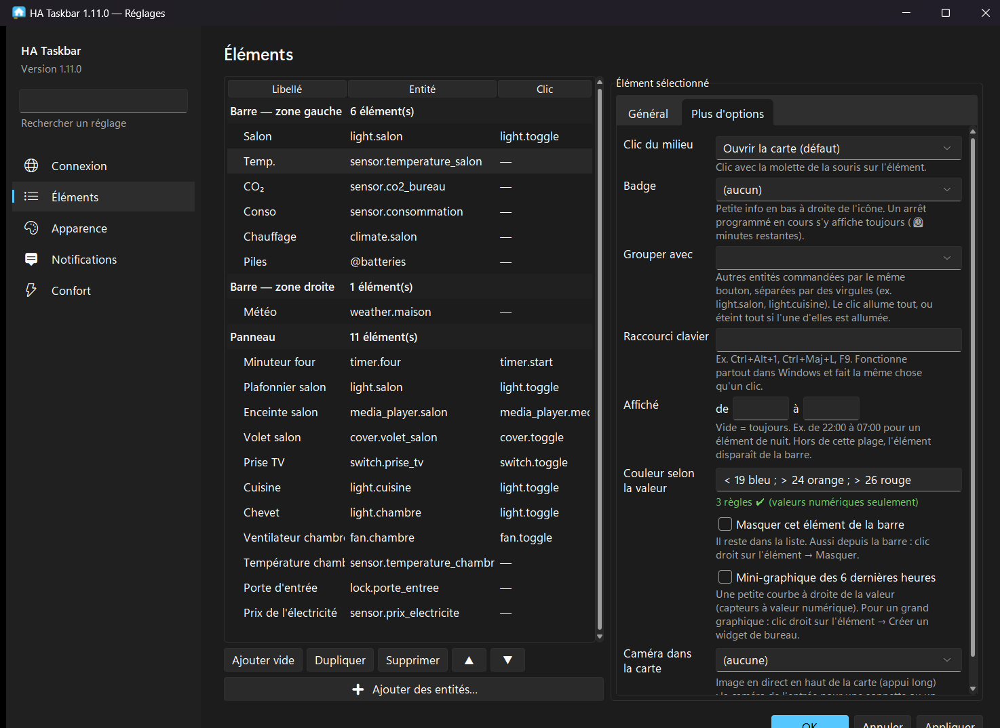

Quand plusieurs règles conviennent, **la plus précise gagne** : avec `> 24 orange ; > 26 rouge`, 27 °C est rouge ; avec `< 40 orange ; < 20 rouge`, 15 % est rouge. L'ordre d'écriture n'a pas d'importance.

Règles prêtes à copier :

| Capteur | Règles |
|---|---|
| Température intérieure (°C) | `< 19 bleu ; > 24 orange ; > 26 rouge` |
| Température extérieure (°C) | `< 0 bleu ; > 30 rouge` |
| Humidité (%) | `< 35 orange ; > 65 bleu` |
| CO₂ (ppm) | `> 800 orange ; > 1200 rouge` |
| Consommation (W) | `> 2000 orange ; > 3000 rouge` |
| Production solaire (W) | `> 100 jaune ; > 1500 vert` |
| Pile d'un appareil (%) | `< 40 orange ; < 20 rouge` |
| Prix de l'électricité (€/kWh) | `< 0,15 vert ; > 0,25 rouge` |
| Qualité de l'air, PM2.5 (µg/m³) | `> 15 orange ; > 35 rouge` |
| Réservoir, cuve (%) | `< 25 orange ; < 10 rouge` |

Couleurs : `rouge`, `orange`, `jaune`, `vert`, `bleu`, `violet`, `rose`, `gris`, `blanc`, `noir` (ou leur nom anglais), ou un code `#rrggbb` (ex. `#00b7c3`). Seules les valeurs numériques sont colorées. Si l'élément affiche un attribut (**Valeur affichée**), c'est sa valeur qui compte.

### 🧩 Recettes pour les options d'un élément

Les options de la lumière de la démo, dans l'onglet **Plus d'options** :

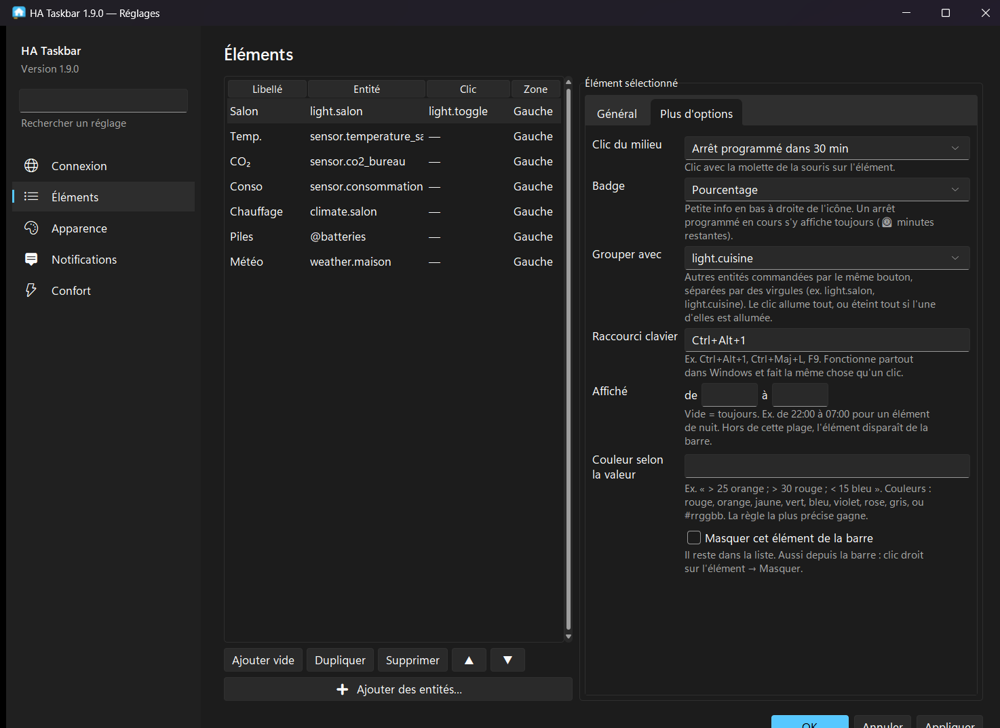

| Je veux… | Où | Réglage |
|---|---|---|
| Éteindre toute une pièce d'un clic | Plus d'options → **Grouper avec** | `light.cuisine, light.couloir` |
| Allumer une lumière sans quitter mon application | Plus d'options → **Raccourci clavier** | `Ctrl+Alt+1` |
| Éteindre la lumière dans 30 min d'un clic du milieu | Plus d'options → **Clic du milieu** | Arrêt programmé dans 30 min |
| Changer le sens d'un ventilateur de plafond (été / hiver) | Plus d'options → **Clic du milieu** et **Badge** | Inverser le sens de rotation, et Sens de rotation ↻ ↺ |
| Voir la luminosité ou la batterie sur l'icône | Plus d'options → **Badge** | Pourcentage, ou Batterie |
| Un élément seulement la nuit | Plus d'options → **Affiché de … à …** | de `22:00` à `07:00` |
| Ranger un élément sans le supprimer | Plus d'options → **Masquer cet élément** | (ou clic droit sur la barre → Masquer) |
| Afficher la température d'un thermostat | Général → **Valeur affichée**, **Unité**, **Décimales** | `current_temperature`, `°C`, `1` |
| Passer le thermostat en éco d'un clic | Général → **Action au clic** et **Données (JSON)** | `climate.set_preset_mode` et `{"entity_id": "climate.salon", "preset_mode": "eco"}` |
| Allumer une lumière à 30 % d'un clic | Général → **Action au clic** et **Données (JSON)** | `light.turn_on` et `{"entity_id": "light.salon", "brightness_pct": 30}` |
| Un capteur qui n'ouvre rien au clic | Général → **Action au clic** | (aucune) — l'appui long ouvre toujours la carte |
| Mettre l'élément à droite de la barre | Général → **Zone** | Droite |

La même lumière, telle qu'elle est enregistrée dans `config.json` :

```json
{
  "entity_id": "light.salon",
  "label": "Salon",
  "group": ["light.cuisine"],
  "badge": "percentage",
  "middle": "@timer30",
  "hotkey": "Ctrl+Alt+1"
}
```

---

## 📝 Fichier de configuration

Les réglages sont stockés dans `config.json`, créé automatiquement :
- version installée : `%APPDATA%\HATaskbar\config.json`
- depuis les sources : à côté du script. Ce fichier **n'est pas versionné**, car il contient ton jeton, chiffré (voir `.gitignore`).

Le jeton n'y apparaît pas en clair : `"token"` reste vide et `"token_protected"` contient sa version chiffrée (voir [Le jeton d'accès](#le-jeton-daccès)). Pour sauvegarder ou partager tes réglages, utilise plutôt **Réglages → Confort → Sauvegarde → Exporter…** : le fichier exporté ne contient jamais le jeton.

Un exemple est fourni dans [`config.example.json`](config.example.json).

Format d'un élément :

```json
{
  "entity_id": "climate.thermostat",
  "label": "Chauffage",
  "card_title": "Chauffage du salon",
  "icon": "flame",
  "attribute": "current_temperature",
  "unit": "°C",
  "decimals": 1,
  "service": "climate.set_preset_mode",
  "data": { "entity_id": "climate.thermostat", "preset_mode": "eco" },
  "zone": "right",
  "middle": "@preset",
  "badge": "percentage",
  "group": ["climate.chambre"],
  "hotkey": "Ctrl+Alt+1",
  "show_from": "22:00",
  "show_to": "07:00",
  "favorites": [{ "name": "Lecture", "brightness_pct": 80, "color_temp_kelvin": 4000 }],
  "cover_positions": [25, 50, 75],
  "thresholds": "> 25 orange ; > 30 rouge",
  "hidden": false
}
```

L'entité spéciale `"@batteries"` est le résumé des piles faibles.

`middle` (clic du milieu) : `"@card"` (par défaut), `"@direction"`, `"@preset"`, `"@timer30"` (ou un autre nombre de minutes), `"@mute"`, `"none"` ou un service. `badge` : `"direction"`, `"percentage"`, `"battery"` ou le nom d'un attribut. `favorites` (lumières) se remplit avec « + Mémoriser » dans la carte.

Notifications (en dehors de `items`) :

```json
"notify_offline": true,
"ha_notifications": true,
"quiet_from": "22:00",
"quiet_to": "07:00",
"notifications": [
  { "entity_id": "binary_sensor.porte_entree", "to": "on", "message": "{name} vient de s'ouvrir" }
]
```

Seul `entity_id` est obligatoire. `icon` peut valoir `"auto"` (par défaut), `"none"`, une clé de `ICONS` dans [`ha_core.py`](ha_core.py), ou une icône animée : `"flame_anim"`, `"fan_anim"`, `"bulb_anim"`, `"eq_anim"`, `"drop_anim"`, `"snow_anim"`, `"sun_anim"`, `"wifi_anim"`, `"bell_anim"`, `"washer_anim"`, `"bolt_anim"`, `"battery_anim"`, `"radar_anim"`, `"heater_anim"`, `"speaker_anim"`, `"timer_anim"`, `"rain_anim"`, `"gear_anim"` (liste dans [`anim_icons.py`](anim_icons.py)). `service` peut valoir `"none"` pour désactiver le clic. `zone` vaut `"left"` (par défaut) ou `"right"`.

Langue : `"language": "auto"` (celle de Windows), `"fr"` ou `"en"`.

Options de l'onglet Confort : `"realtime": true`, `"palette_hotkey": "Ctrl+Alt+Space"`, `"compact": false`, `"tooltips": true`, `"flash_changes": true`, `"battery_low": 20`.

L'écran est `monitor` : vide pour l'écran principal, sinon son nom Windows (par exemple `"\\\\.\\DISPLAY2"` dans le fichier JSON).

Les décalages des deux zones sont `offset` (zone gauche, depuis le bord gauche) et `offset_right` (zone droite, depuis le bord droit). Une ancienne configuration réglée sur le côté droit (`"anchor": "right"`) est convertie toute seule : ses éléments passent dans la zone droite.

---

## 🧠 Comment ça marche

Windows 11 ne permet plus d'ajouter des « deskbands » (barres d'outils) à la barre des tâches. HA Taskbar contourne cela :

1. Une **petite fenêtre sans bordure** par zone (gauche et droite), « toujours au premier plan », est posée **par-dessus** la barre des tâches. Elle reprend exactement sa hauteur et sa position, grâce à l'API Win32 `FindWindow("Shell_TrayWnd")`.
2. La barre des tâches repasse devant à chaque clic. La fenêtre se remet donc au premier plan **dès qu'une fenêtre devient active** (hook `EVENT_SYSTEM_FOREGROUND`), et en plus toutes les 0,4 s.
3. La fenêtre est de type « outil » et « non activable » : elle n'apparaît ni dans Alt+Tab ni dans la barre des tâches, et ne vole pas le focus.
4. Un **thread** reste connecté à l'**API WebSocket** de Home Assistant (`/api/websocket`) et s'abonne aux changements d'état (`state_changed`), aux notifications persistantes et à l'événement `ha_taskbar_notify`. Le client WebSocket est écrit en Python pur ([`ha_ws.py`](ha_ws.py)) et se reconnecte tout seul. Un second thread lit tous les états d'un coup (`GET /api/states`) : à intervalle régulier sans temps réel, une fois par minute sinon, pour se resynchroniser. Les clics appellent `POST /api/services/<domaine>/<service>`. La carte de contrôle lit l'historique avec `GET /api/history/period/…`, et les prévisions météo avec le service `weather.get_forecasts`.
5. Pour éviter tout scintillement, un élément n'est redessiné que si sa valeur change, et sa largeur ne rétrécit jamais.
6. **Fond transparent** : la couleur de fond est déclarée « transparente » (`-transparentcolor`). Windows laisse alors passer les clics à travers les pixels transparents. Une seconde fenêtre presque invisible (opacité 1 %), placée juste sous la barre, récupère ces clics et les transmet au bouton situé sous la souris. Tout le rectangle d'un bouton reste ainsi cliquable.

---

## 📁 Structure du projet

| Fichier | Rôle |
|---|---|
| [`ha_taskbar.py`](ha_taskbar.py) | Point d'entrée : la barre (fenêtre, positionnement, boutons, rafraîchissement) |
| [`card_ui.py`](card_ui.py) | Carte de contrôle (appui long) : curseurs, interrupteur, modes, historique 24 h |
| [`settings_ui.py`](settings_ui.py) | Fenêtre de réglages, sélecteur d'entités, sélecteur d'icônes |
| [`ha_core.py`](ha_core.py) | Commun : config, client Home Assistant, icônes, actions par défaut, démarrage auto |
| [`anim_icons.py`](anim_icons.py) | Icônes animées : dessin vectoriel et rendu anticrénelé en Python pur (aucune dépendance) |
| [`ui_theme.py`](ui_theme.py) | Apparence Windows 11 des fenêtres : thème clair/sombre, menu latéral |
| [`sv_ttk/`](sv_ttk/) | Thème [Sun Valley](https://github.com/rdbende/Sun-Valley-ttk-theme) de rdbende (licence MIT), fourni tel quel |
| [`ha_ws.py`](ha_ws.py) | Connexion temps réel : client WebSocket minimal et abonnement aux événements de Home Assistant |
| [`palette.py`](palette.py) | Palette de commandes (recherche dans toutes les entités) |
| [`tooltip_ui.py`](tooltip_ui.py) | Infobulle au survol et sa mini-courbe |
| [`i18n.py`](i18n.py), [`i18n_en.py`](i18n_en.py) | Langue de l'interface (celle de Windows ou celle choisie) et traductions anglaises |
| [`tray.py`](tray.py) | Icône dans la zone de notification (API Windows, sans dépendance) |
| [`update_ui.py`](update_ui.py) | Fenêtre de mise à jour : nouveautés, téléchargement vérifié, installation |
| `config.example.json` | Exemple de configuration |
| `config.json` | Ta configuration (créée automatiquement, ignorée par git) |
| [`SECURITY.md`](SECURITY.md) | Signaler une faille de sécurité |
| [`build.ps1`](build.ps1) | Construit l'exe (PyInstaller) puis le programme d'installation (Inno Setup) |
| [`installer/ha_taskbar.iss`](installer/ha_taskbar.iss) | Script Inno Setup : raccourcis, démarrage auto, désinstallation |
| [`installer/portable.txt`](installer/portable.txt) | Mode d'emploi de la version portable ; sa présence à côté de l'exe active ce mode |
| [`assets/`](assets/) | Icône du programme |
| [`tools/make_icon.py`](tools/make_icon.py) | Génère l'icône (`python tools/make_icon.py`) |

---

## 🚧 Limites connues

- Les boutons s'affichent sur **un seul écran** à la fois (au choix dans les réglages).
- Avec la barre des tâches en **masquage automatique**, la fenêtre ne suit pas l'animation.
- En fond transparent, le contour du texte est lissé sur la couleur « Fond ». Garde une couleur proche de ta barre des tâches (`#202020` en thème sombre, ou le thème clair pour une barre claire), sinon un léger liseré peut apparaître.
- Une mise à jour de Windows peut modifier le comportement de la barre des tâches.
- Sans la connexion temps réel (désactivée, ou impossible à établir), HA Taskbar interroge Home Assistant à intervalle régulier : une notification peut alors arriver jusqu'à un intervalle après le changement, et un état qui change puis revient entre deux lectures passe inaperçu.
- La **palette de commandes** ne règle que ce que gère la molette (luminosité, vitesse, volume, position, consigne, nombres). Pour le reste, Tab ouvre la carte.
- L'**arrêt programmé** est géré par HA Taskbar : si le PC s'éteint ou si l'application est fermée, l'appareil reste allumé. Pour un minuteur fiable, utilise celui de l'appareil quand il en a un (il s'affiche dans « Sur le même appareil »).
- La **pochette** d'un morceau n'est pas affichée : Tk ne lit pas les images JPEG sans bibliothèque externe.

---

## 🩺 Dépannage

| Symptôme | Solution |
|---|---|
| **● HA** rouge, « HTTP 401 » | Jeton invalide ou révoqué : recrée-le dans Home Assistant |
| « Connexion impossible » | Vérifie l'adresse (http/https, port 8123) et que le PC joint Home Assistant |
| Erreur de certificat | Décoche **Vérifier le certificat HTTPS** |
| La barre recouvre des icônes | Ajuste le **décalage** de la zone concernée (gauche ou droite) dans l'onglet Apparence |
| « HA Taskbar est déjà lancé » | Une instance tourne déjà : clic sur l'icône près de l'horloge (ou clic droit sur la barre) → Réglages |
| Rien ne s'affiche | Lance avec `python ha_taskbar.py` (et non `pythonw`) pour voir les erreurs dans la console |

---

## 💬 À propos de ce projet

Je ne suis pas développeur 😄 J'ai apporté les idées, les tests et les retours au fil de l'eau. Toute la partie technique (code, programme d'installation, documentation et captures) a été réalisée par **Claude**, l'assistant IA d'Anthropic, à partir de mes demandes.

---

## 🍎 HA Taskbar sur Mac

Depuis la 1.8, HA Taskbar existe aussi pour **macOS 13 ou plus récent** (Apple Silicon et Intel). C'est une application native : les éléments s'affichent dans la **barre des menus**, en haut à droite de l'écran.


*Lumière allumée à 70 % (en jaune), chauffage en marche (la flamme s'anime), consommation et température extérieure. Données de démonstration.*

Un **appui long** (ou ⌥-clic, ou le survol) ouvre la carte de contrôle, comme sur Windows : lumière, thermostat, historique d'un capteur…

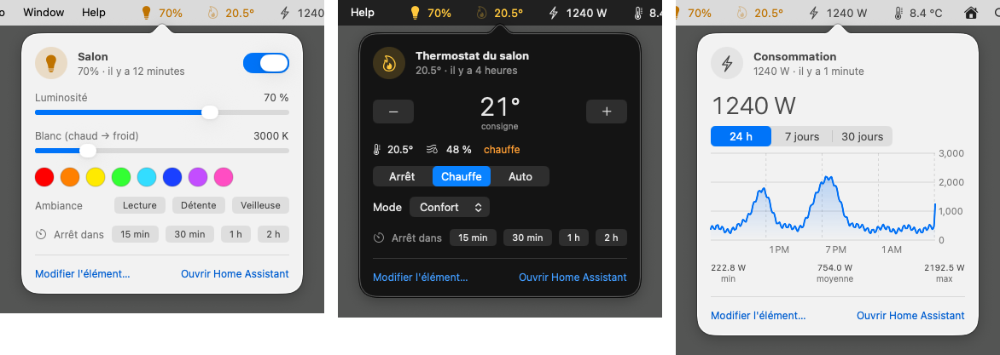

Les **widgets de bureau** se créent et se règlent dans l'onglet **Widgets** :

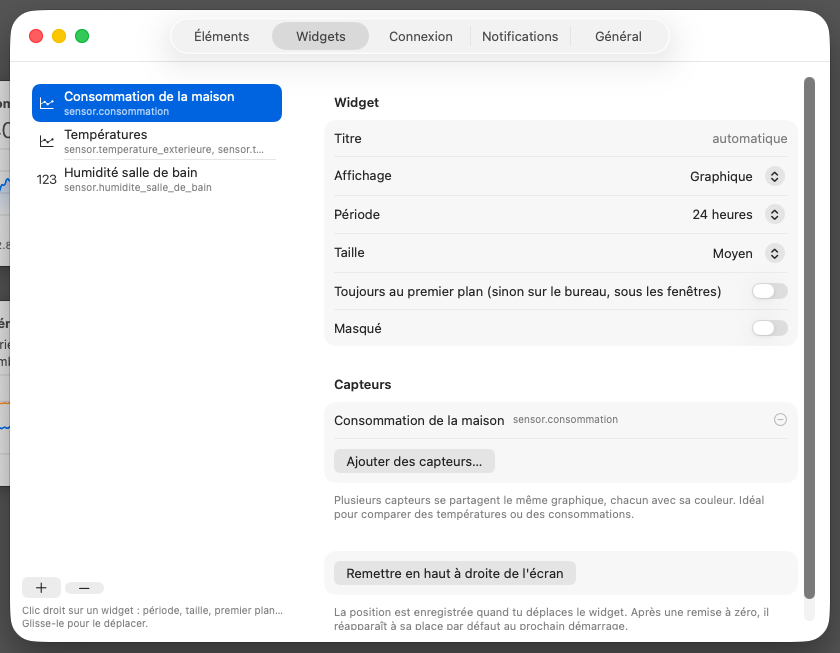

Les réglages et le choix des entités, avec la pièce de chacune :

<p align="center">
  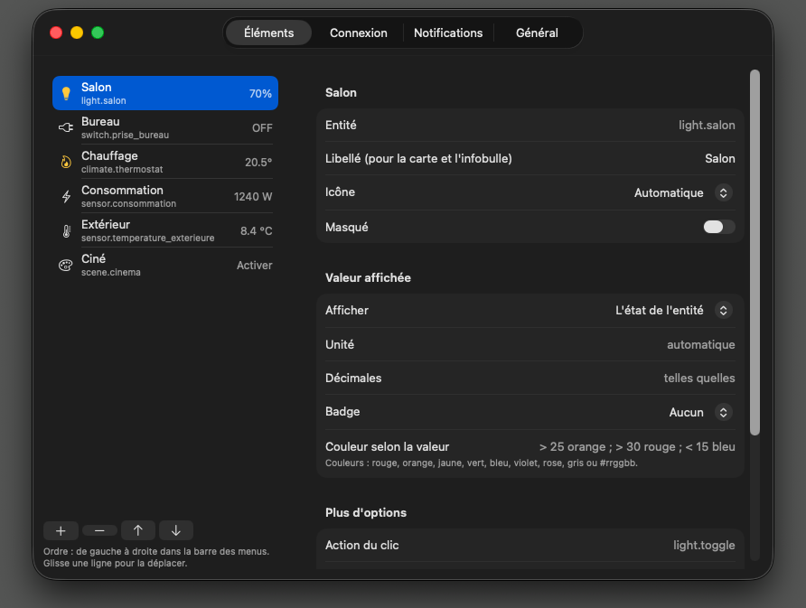
  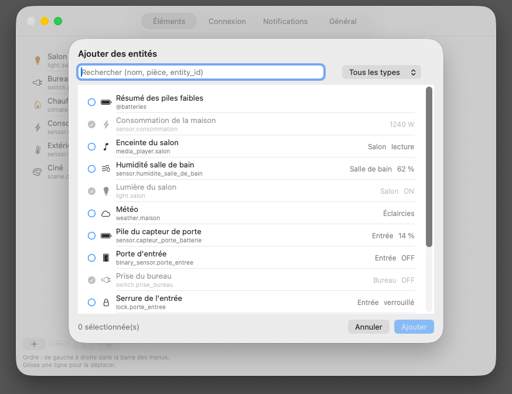
</p>

- **Installation (recommandée)** : colle cette commande dans le **Terminal** (Applications → Utilitaires) :

  ```bash
  curl -fsSL https://raw.githubusercontent.com/bbtoff/home-assistant-taskbar/main/macos/install.sh | bash
  ```

  Elle télécharge la dernière version depuis les Releases, vérifie son empreinte SHA-256, l'installe dans **Applications** et la lance. Aucun message « Apple n'a pas pu confirmer… » : macOS ne bloque que les fichiers téléchargés par un navigateur. Le script est lisible ici : [`macos/install.sh`](macos/install.sh).
- **Mises à jour** : automatiques. HA Taskbar vérifie GitHub au démarrage puis une fois par jour, propose la nouvelle version, la télécharge, vérifie son empreinte et redémarre (menu 🏠 → **Mettre à jour**, ou **Réglages → Général → Mises à jour**).
- **Avec le `.dmg`** (téléchargé depuis les [**Releases**](https://github.com/bbtoff/home-assistant-taskbar/releases)) : l'application n'est pas signée par Apple, donc macOS la bloque au premier lancement. Ouvre **Réglages Système → Confidentialité et sécurité**, puis **Ouvrir quand même** (une seule fois : les mises à jour suivantes se font depuis l'application).
- **Utilisation** : clic pour l'action, survol (0,8 s), appui long ou ⌥-clic pour la carte, molette pour régler, clic droit pour le menu. Si tu préfères que le clic ouvre la carte : **Réglages → Général → Clic sur un élément**.
- **Depuis Windows** : **Réglages → Général → Importer…** reprend ton `config.json` (éléments, icônes, seuils, notifications).

La palette de commandes, les raccourcis clavier globaux et les favoris de lumière ne sont pas encore disponibles sur Mac. Tout le détail, et comment la construire soi-même avec Xcode : [macos/README.md](macos/README.md).
