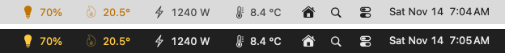
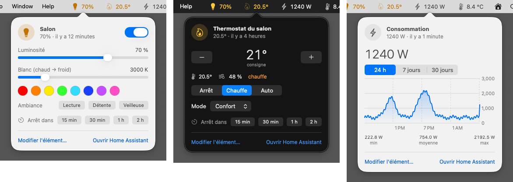
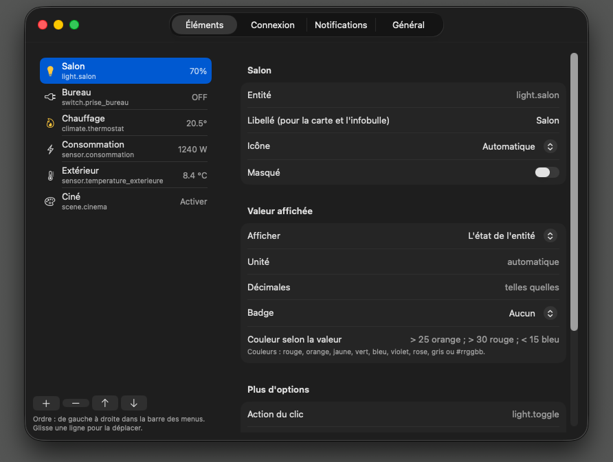
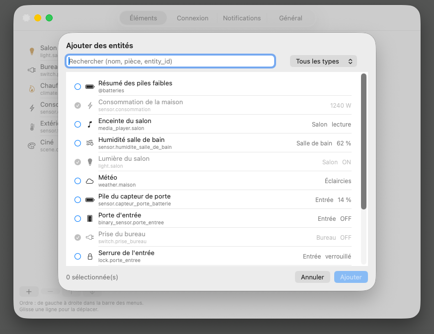

# HA Taskbar pour macOS

La version Mac de HA Taskbar : tes **capteurs** et **boutons Home Assistant** dans la **barre des menus**, en haut à droite de l'écran. Application native (Swift, AppKit + SwiftUI), sans aucune dépendance.





<p align="center">
  
  
</p>

*Captures faites avec les données de démonstration (`--demo`, voir plus bas).*

## Ce qu'elle fait

- 📊 **Valeurs en temps réel** (WebSocket), avec repli automatique sur l'interrogation régulière
- 💡 **Clic** : allumer / éteindre, lancer une scène ou un script… (sur un capteur : ouvre la carte)
- 🧩 **Appui long**, **⌥-clic** ou clic du milieu : **carte de contrôle** — luminosité, blanc, couleurs, ambiances, vitesse et sens d'un ventilateur, position d'un volet, consigne et mode d'un thermostat, lecteur multimédia, verrou, aspirateur, liste déroulante, météo sur 5 jours, **historique 24 h / 7 j / 30 j** avec courbe
- 🖱️ **Molette ou deux doigts** sur un élément : luminosité, vitesse, volume, position, consigne, valeur
- 📋 **Clic droit** (ou ⌃-clic) : menu de l'élément, **arrêt programmé** (15 min à 2 h), modifier, masquer
- 🎨 Plus de 100 icônes **SF Symbols** qui suivent l'état (jaune = allumé), pile / Wi-Fi / volume selon la valeur, **icônes animées** (macOS 14+), **couleur selon la valeur** (`> 25 orange ; > 30 rouge`)
- 👥 Groupes, plages horaires d'affichage, badges, résumé des **piles faibles**
- 🔔 **Notifications macOS** : règles par entité, Home Assistant hors ligne / de retour, notifications persistantes et événement `ha_taskbar_notify`, plage sans notification et pause
- 🔒 Le jeton est rangé dans le **trousseau macOS**
- 💾 **Import du `config.json` de la version Windows** (éléments, icônes, seuils, notifications) et export sans le jeton

## Construire l'application

Il faut **Xcode** (ou seulement les outils en ligne de commande : `xcode-select --install`). Dans le Terminal :

```bash
cd home-assistant-taskbar/macos
```

```bash
./build.sh
```

Le script produit dans `macos/dist/` :

- `HA Taskbar.app` — l'application (Intel et Apple Silicon)
- `HATaskbar-macOS-<version>.zip` et `.dmg`

Glisse **HA Taskbar** dans **Applications**, puis lance-la. Au premier lancement, la fenêtre de réglages s'ouvre sur l'onglet **Connexion** : adresse de Home Assistant et **jeton d'accès longue durée** (dans Home Assistant : ton profil → Sécurité → Jetons d'accès longue durée). Ajoute ensuite tes entités avec le bouton **+** de l'onglet **Éléments**.

Pour la lancer à l'ouverture de session : **Réglages → Général → Démarrage**.

### Depuis Xcode

Double-clique sur `macos/Package.swift` : Xcode ouvre le projet, ▶︎ lance l'application. Les notifications et le lancement à l'ouverture de session ne marchent que depuis l'application construite par `build.sh` (macOS les réserve aux vraies applications `.app`).

### Sans Mac de développement

Chaque modification du dossier `macos/` est construite sur un Mac de GitHub (workflow **macOS**) : le `.zip` et le `.dmg` sont dans les **Artifacts** de l'exécution. L'application n'est pas notariée par Apple : au premier lancement, clic droit → **Ouvrir** (ou **Réglages Système → Confidentialité et sécurité → Ouvrir quand même**).

## Mode démonstration

Pour essayer sans Home Assistant, ou refaire les captures : lance l'application avec `--demo` (rien n'est enregistré ni envoyé).

```bash
"/Applications/HA Taskbar.app/Contents/MacOS/HATaskbar" --demo
```

Options : `--demo-card <n>` ouvre la carte du n-ième élément, `--demo-settings` les réglages, `--demo-picker` l'ajout d'entités, `--demo-items 0,2,3` limite les éléments affichés. Le workflow **macOS (captures)** de GitHub refait toutes les captures de cette façon.

## Différences avec Windows

| Windows | macOS |
|---|---|
| Barre des tâches, zones gauche et droite | Barre des menus, à droite (macOS ne permet pas d'y placer quoi que ce soit à gauche) |
| Icônes Segoe Fluent | SF Symbols (les noms d'icônes de la config Windows sont reconnus) |
| Ctrl + glisser pour déplacer | Ordre de la liste dans Réglages → Éléments (glisser une ligne) |
| Thèmes de la carte | La carte suit le thème clair / sombre de macOS |

Pas encore sur Mac : la palette de commandes (Ctrl+Alt+Espace), les raccourcis clavier globaux et les favoris de lumière.

> 💡 Sur un MacBook avec encoche, les éléments de trop sont cachés derrière l'encoche : active la **barre compacte** (Réglages → Général) pour n'afficher que les icônes.

## Confidentialité

Comme sous Windows : HA Taskbar ne se connecte qu'à **ton** Home Assistant. La configuration est dans `~/Library/Application Support/HATaskbar/config.json` (sans le jeton), le jeton dans le trousseau (« HATaskbar »).
